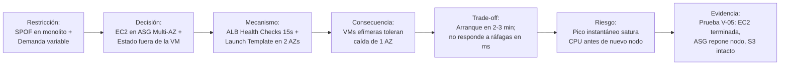

# Guía de Defensa Individual: Justificación de Decisiones Arquitectónicas
## Proyecto Digital Café Luna · Computación en Nube 2026-2 · Evaluación Final
**Profesor:** Ing. Luis Eduardo  
**Formato de evaluación:** Defensa individual virtual (10 minutos de explicación + 2 preguntas)  
**Objetivo rector:** Demostrar comprensión profunda de las decisiones de diseño mediante el hilo conductor:  
$$\text{Restricción} \longrightarrow \text{Decisión} \longrightarrow \text{Mecanismo} \longrightarrow \text{Consecuencia} \longrightarrow \text{Trade-off} \longrightarrow \text{Riesgo Residual} \longrightarrow \text{Evidencia Observable}$$

---

## 1. Estructura de los 10 Minutos de Exposición

Para no perder tiempo en generalidades ni sonar como una presentación genérica, la exposición debe seguir este esquema sobrio y directo:

```
[0:00 - 1:30]  1. El problema concreto y la restricción central del caso.
[1:30 - 3:30]  2. Topología de Red y Cómputo Elástico Multi-AZ (Decisiones 1 y 2).
[3:30 - 5:30]  3. Desacoplamiento Asíncrono de Órdenes y Persistencia Externa (Decisiones 3 y 4).
[5:30 - 7:30]  4. Seguridad, Mínimo Privilegio y Telemetría de Ciclo Cerrado (Decisiones 5 y 6).
[7:30 - 8:45]  5. Decisiones FinOps conscientes: lo que se desplegó en dev vs. el código de producción.
[8:45 - 10:00] 6. Resumen de límites actuales y qué fallaría primero bajo mayor escala.
```

---

## 2. Las 6 Decisiones Maestras de la Arquitectura

A continuación se fundamenta cada decisión crítica bajo la estructura exacta requerida por el docente. Utiliza estos bloques para estudiar, interiorizar el razonamiento y responder con criterio propio:

---

### Decisión 1: Cómputo Elástico Multi-AZ Desacoplado del Almacenamiento



1. **Restricción que justificó la decisión:** En el monolito tradicional, la aplicación y los datos residían en un único servidor. Si el hardware fallaba, el canal digital salía de línea por completo (`RNF-3`, `RF-4`). Además, la demanda de café presenta picos marcados en la mañana y tarde; mantener servidores fijos para el pico genera capacidad ociosa y sobrecostos.
2. **Qué se decidió:** Separar el cómputo de la persistencia y desplegar instancias efímeras Amazon Linux 2023 dentro de un Auto Scaling Group (Min=2, Desired=2, Max=4) distribuido activamente entre dos Availability Zones (`us-east-1a` y `us-east-1b`), coordinadas por un Application Load Balancer.
3. **Mecanismo técnico:** Un Target Group en el ALB realiza health checks en `/health` cada 15 segundos con umbral de 2 fallos consecutivos. Si una instancia no responde, el ALB deja de enrutarle tráfico en 30 segundos y el ASG lanza un reemplazo a partir del Launch Template.
4. **Consecuencia técnica:** Alta disponibilidad activa-activa. Si una máquina o una AZ completa sufre un corte, el tráfico es absorbido por la otra zona sin interrupción de servicio para el cliente.
5. **Trade-off aceptado:** El autoescalado elástico basado en máquinas virtuales toma entre 90 y 180 segundos en responder (tiempo que tarda AWS en iniciar la VM, ejecutar el User Data, instalar Docker y arrancar los contenedores). No reacciona en milisegundos.
6. **Riesgo que permanece:** Un incremento violento de tráfico en menos de 60 segundos agotará los créditos de CPU de las instancias `t3.micro` antes de que el ASG complete el aprovisionamiento de un nuevo nodo.
7. **Cómo se demuestra que funciona (Evidencia):** En la **Prueba V-05**, se terminó forzadamente una de las instancias EC2 en consola. Se observó cómo el ALB canalizó el 100% de las peticiones a la instancia superviviente y el ASG aprovisionó automáticamente una nueva máquina que se registró como saludable sin pérdida de estado ([`InstancesDuringProofB.jpeg`](file:///home/lacastrilp/Documentos/Semestre_2026_2/Com_Nube/DigitalCafeLuna/Digital_Cafe_Luna/Laboratorios%20Evolutivos/Laboratorio%203/Proof%20B/During/InstancesDuringProofB.jpeg) y [`NewTargets.png`](file:///home/lacastrilp/Documentos/Semestre_2026_2/Com_Nube/DigitalCafeLuna/Digital_Cafe_Luna/Laboratorios%20Evolutivos/Laboratorio%203/NewTargets.png)).

---

### Decisión 2: Desacoplamiento Asíncrono de Órdenes mediante Cola Amazon SQS

1. **Restricción que justificó la decisión:** Si el proceso de cobro, facturación o confirmación de pedidos se ejecuta de forma síncrona en la misma llamada HTTP del usuario, cualquier lentitud o caída del backend congela la navegación del cliente y genera errores de timeout (`RF-2`).
2. **Qué se decidió:** Introducir una cola de mensajería intermedia Amazon SQS Standard (`dcl-dev-orders-queue`) entre la recepción de la orden y el procesamiento de fondo.
3. **Mecanismo técnico:** El endpoint `POST /checkout` de la API recibe la compra, genera un identificador de orden (`DCL-XXXX`), deposita el evento `ORDER_CREATED` en SQS y responde inmediatamente `HTTP 202 Accepted` al cliente. De forma desacoplada, un proceso `worker.py` consume los mensajes mediante Long Polling (`WaitTimeSeconds=5`) a su propio ritmo.
4. **Consecuencia técnica:** Desacoplamiento temporal. La capa web queda liberada de la carga de procesamiento y el cliente recibe una respuesta instantánea independientemente del volumen de pedidos entrantes.
5. **Trade-off aceptado:** Consistencia eventual. El cliente recibe confirmación de que su pedido fue encolado, pero el procesamiento definitivo ocurre unos segundos más tarde en diferido.
6. **Riesgo que permanece:** SQS Standard garantiza entrega *at-least-once* (al menos una vez). Si el worker procesa el pedido pero experimenta una caída de red antes de borrar el mensaje de la cola (`sqs.delete_message`), el mensaje reaparecerá tras el `VisibilityTimeout` (30s) y podría procesarse duplicado. El worker debe implementar idempotencia en producción.
7. **Cómo se demuestra que funciona (Evidencia):** En la prueba de desacoplamiento, se apagó el worker y se enviaron 3 pedidos desde la aplicación. Los mensajes se retuvieron intactos en la cola (`ApproximateNumberOfMessages=3`). Al reactivar el worker, la cola se drenó por completo a 0 y los pedidos fueron procesados en orden sin perderse ([`ConsumerOFFProducerON3Messages.png`](file:///home/lacastrilp/Documentos/Semestre_2026_2/Com_Nube/DigitalCafeLuna/Digital_Cafe_Luna/LabsCalificables/Desacoplamiento/ConsumerOFFProducerON3Messages.png) y [`ReactivarConsumerSeProcesaCola.png`](file:///home/lacastrilp/Documentos/Semestre_2026_2/Com_Nube/DigitalCafeLuna/Digital_Cafe_Luna/LabsCalificables/Desacoplamiento/ReactivarConsumerSeProcesaCola.png)).

---

### Decisión 3: Cero NAT Gateways Permanentes en Desarrollo (Decisión FinOps)

1. **Restricción que justificó la decisión:** El presupuesto asignado para el proyecto era de $20 USD mensuales (`RNF-4`) bajo un entorno de AWS Academy / Learner Lab. El diseño clásico de producción contemplaba 2 NAT Gateways (uno por AZ), lo cual genera un costo fijo de ~$65 USD mensuales (~$0.045/hora por NAT Gateway sin contar la transferencia de datos), agotando el crédito en pocos días.
2. **Qué se decidió:** Omitir conscientemente los NAT Gateways permanentes en el despliegue del entorno de desarrollo continuo, ubicando temporalmente las EC2 en subredes públicas con IPs públicas administradas, mientras que el código de Terraform conserva la arquitectura ideal con NAT Gateways para producción.
3. **Mecanismo técnico:** Se compensó el riesgo de red aplicando **Seguridad en Profundidad**: se cerró completamente el puerto 22 (SSH) hacia Internet, el Security Group solo permite tráfico HTTP en el puerto 8080 proveniente exclusivamente del Security Group del balanceador, y se forzó IMDSv2 en las instancias.
4. **Consecuencia técnica:** Se eliminó un costo fijo de ~$65 USD mensuales, permitiendo operar y validar toda la solución manteniéndose estrictamente dentro del presupuesto de $20 USD.
5. **Trade-off aceptado:** Las interfaces de red de las instancias de cómputo tuvieron asignada una IP pública en desarrollo, renunciando temporalmente al aislamiento estricto de capa de red (subredes privadas) que se diseñó en Hito 2.
6. **Riesgo que permanece:** Si un integrante comete un error humano en la consola y abre una regla de Security Group hacia `0.0.0.0/0`, la máquina quedaría directamente expuesta a escaneos en Internet.
7. **Cómo se demuestra que funciona (Evidencia):** La tabla de costos del Hito 4 demuestra que el gasto acumulado no superó los $20 USD; la captura [`Public_SG.png`](file:///home/lacastrilp/Documentos/Semestre_2026_2/Com_Nube/DigitalCafeLuna/Digital_Cafe_Luna/Infraestructura%20base/Public_SG.png) confirma las reglas cerradas y un intento de conexión SSH externo fue rechazado por timeout.

---

### Decisión 4: Erradicación de Credenciales Estáticas con IAM Roles e IMDSv2

1. **Restricción que justificó la decisión:** En el monolito previo, las credenciales de base de datos y llaves de acceso cloud estaban quemadas en archivos de texto plano dentro del servidor (`RNF-2`, `RNF-6`). Si un atacante comprometía la máquina, obtenía acceso persistente e ilimitado a toda la cuenta de AWS.
2. **Qué se decidió:** Prohibir de forma absoluta el uso de Access Keys y Secret Keys estáticas en código, contenedores o servidores. Toda autenticación se realiza mediante IAM Instance Profiles temporales (`dcl-dev-role-web`) y llamadas obligatorias bajo IMDSv2.
3. **Mecanismo técnico:** Cada máquina virtual recibe un Instance Profile asociado a un rol asumido por `ec2.amazonaws.com`. El SDK Boto3 solicita tokens temporales de STS rotados automáticamente por AWS. Además, el Launch Template fuerza `http_tokens = "required"` con un hop limit = 1, neutralizando ataques de Server-Side Request Forgery (SSRF).
4. **Consecuencia técnica:** Si un atacante extrae el disco EBS o inspecciona las variables del sistema operativo, no encuentra secretos reutilizables fuera del entorno de cómputo.
5. **Trade-off aceptado:** Mayor complejidad en la configuración de contenedores Docker: para que las aplicaciones en contenedor puedan consumir IMDSv2 con hop limit = 1 sin ser bloqueadas por el salto de red virtual, deben correr en modo `--network host`.
6. **Riesgo que permanece:** El rol IAM actual incluye tanto permisos de publicación (`sqs:SendMessage`) como de consumo (`sqs:ReceiveMessage`, `sqs:DeleteMessage`) debido a que la API web y el worker coexisten en el mismo host físico.
7. **Cómo se demuestra que funciona (Evidencia):** Ejecución del comando `aws sts get-caller-identity` dentro de la instancia EC2 demostrando que la identidad activa es un rol temporal asumido (`assumed-role/dcl-dev-role-web/...`) y no un usuario IAM estático ([`Sesion_Identidad.png`](file:///home/lacastrilp/Documentos/Semestre_2026_2/Com_Nube/DigitalCafeLuna/Digital_Cafe_Luna/Laboratorios%20Evolutivos/Laboratorio%201/Sesion_Identidad.png) e [`IAMRole.png`](file:///home/lacastrilp/Documentos/Semestre_2026_2/Com_Nube/DigitalCafeLuna/Digital_Cafe_Luna/LAB%203%20-%20Operación%20segura%20y%20observable/evidencias/IAMRole.png)).

---

### Decisión 5: Cadena de Observabilidad Operacional con Metric Filter y Alarma de 60 Segundos

1. **Restricción que justificó la decisión:** En la infraestructura previa no existía visibilidad del comportamiento del sistema; el equipo solo se enteraba de una falla cuando los usuarios reportaban la caída del servicio (`RNF-3`). Se requería una detección proactiva de errores 500 en menos de 2 minutos.
2. **Qué se decidió:** Implementar una cadena de telemetría desacoplada: la aplicación escribe logs estructurados en disco local → el CloudWatch Agent los transmite a `/dcl/dev/ops` con retención de 7 días → un Metric Filter extrae el patrón `ERROR` hacia la métrica `ErrorCount` → una Alarma CloudWatch evalúa `Sum(ErrorCount) >= 1` en periodos de 60 segundos.
3. **Mecanismo técnico:** Desacoplar la ingestión del análisis numérico. El agente envía logs de forma asíncrona; el Metric Filter de CloudWatch convierte texto en una señal cuantitativa evaluable por el motor de alarmas sin saturar la CPU de la instancia.
4. **Consecuencia técnica:** Detección de fallos en tiempo cuasi-real (~60-90 segundos) y correlación inmediata: la alarma apunta al minuto exacto y al Log Stream de la instancia responsable.
5. **Trade-off aceptado:** Costo variable por volumen de ingestión en CloudWatch Logs (mitigado con retención de 7 días) y latencia inherente de 60 segundos en la ventana de agregación (la detección no ocurre en milisegundos).
6. **Riesgo que permanece:** Si una falla genera una tormenta de millones de logs de error en pocos minutos, la alarma se disparará de inmediato, pero el costo de ingestión de CloudWatch Logs crecerá proporcionalmente.
7. **Cómo se demuestra que funciona (Evidencia):** Registro cronológico verificado T0–T3: a las 19:58:01Z se inyectó `/simulate-error` (T0) → a las 19:58:09Z el log apareció en CloudWatch (T1) → a las 19:58:40Z el filtro emitió `ErrorCount=1` (T2) → a las 19:59:15Z la alarma pasó a `ALARM` (T3) → y retornó a `OK` tras reanudar tráfico saludable con `/health` ([`T0SimulatedError.png`](file:///home/lacastrilp/Documentos/Semestre_2026_2/Com_Nube/DigitalCafeLuna/Digital_Cafe_Luna/LAB%203%20-%20Operación%20segura%20y%20observable/evidencias/T0SimulatedError.png), [`T2SumErrorCount.png`](file:///home/lacastrilp/Documentos/Semestre_2026_2/Com_Nube/DigitalCafeLuna/Digital_Cafe_Luna/LAB%203%20-%20Operación%20segura%20y%20observable/evidencias/T2SumErrorCount.png), [`T3Alarm.png`](file:///home/lacastrilp/Documentos/Semestre_2026_2/Com_Nube/DigitalCafeLuna/Digital_Cafe_Luna/LAB%203%20-%20Operación%20segura%20y%20observable/evidencias/T3Alarm.png), [`T3AlarmRetornoOK.png`](file:///home/lacastrilp/Documentos/Semestre_2026_2/Com_Nube/DigitalCafeLuna/Digital_Cafe_Luna/LAB%203%20-%20Operación%20segura%20y%20observable/evidencias/T3AlarmRetornoOK.png)).

---

### Decisión 6: Validación de Estado Externo mediante Amazon S3 en lugar de RDS Continuo en Desarrollo

1. **Restricción que justificó la decisión:** `RF-4` exige demostrar empíricamente que el cómputo y el almacenamiento escalan y fallan de forma independiente. Sin embargo, mantener un cluster PostgreSQL Multi-AZ encendido de forma continua agotaba los créditos de laboratorio y demoraba 15 minutos en cada aprovisionamiento.
2. **Qué se decidió:** Alojar el estado compartido de pedidos y catálogo en un bucket Amazon S3 privado y cifrado (`dcl-dev-state-*-team-01`, `state/dcl-state.json`) para validar el desacoplamiento en las pruebas del semestre, mientras que el código completo de Amazon RDS PostgreSQL Multi-AZ con Secrets Manager quedó declarado en Terraform (`database.tf`).
3. **Mecanismo técnico:** Las instancias EC2 descargan el JSON desde S3 al arrancar mediante llamadas al API autenticadas por el rol IAM y sirven peticiones concurrentes desde `us-east-1a` y `us-east-1b` leyendo la misma fuente externa.
4. **Consecuencia técnica:** Se demostró con éxito el principio de *cómputo sin estado* (`stateless compute`): cualquier máquina virtual puede morir y su reemplazo lee exactamente los mismos datos desde S3, con costo prácticamente nulo.
5. **Trade-off aceptado:** S3 no ofrece transaccionalidad ACID ni bloqueos de fila a nivel de base de datos; solo ofrece consistencia de lectura tras escritura sobre objetos completos.
6. **Riesgo que permanece:** Concurrencia de escritura: dos compras simultáneas del último paquete de café sobre el archivo JSON en S3 provocarían una condición de carrera (race condition). Por eso RDS es indispensable para producción.
7. **Cómo se demuestra que funciona (Evidencia):** Peticiones concurrentes al DNS del balanceador alternando entre nodos de distintas AZs donde ambos responden con el mismo `s3_state`, y comprobación de que al destruir una instancia del ASG el archivo en S3 permanece intacto ([`HTTPResponses.png`](file:///home/lacastrilp/Documentos/Semestre_2026_2/Com_Nube/DigitalCafeLuna/Digital_Cafe_Luna/Laboratorios%20Evolutivos/Laboratorio%203/HTTPResponses.png) y DOCX Sección 2.1).

---

## 3. Preparación para Preguntas con Cambio de Condiciones ("What-if Scenarios")

El profesor advierte: *"También podré modificar alguna condición del caso y preguntarles qué mantendrían, qué cambiarían y por qué."* A continuación se analizan los 5 cambios de condición más probables:

---

### Escenario A: *"Si el presupuesto de la empresa aumenta de $20 a $300 USD mensuales, ¿qué cambias y qué mantienes?"*
- **Qué cambio:**
  1. Activo los 2 NAT Gateways en `network.tf` y muevo las instancias EC2 a subredes 100% privadas.
  2. Despliego el cluster Amazon RDS PostgreSQL Multi-AZ (`db.t3.micro`, gp3) con contraseña gestionada por Secrets Manager.
  3. Adquiero un dominio público en Route 53 e implemento un certificado ACM para habilitar HTTPS/TLS 1.3 en el puerto 443 del ALB.
  4. Agrego AWS WAF delante del ALB para mitigar inyecciones SQL y ataques DoS.
- **Qué mantengo:** La topología de 3 capas, el balanceador ALB, el Auto Scaling Group en dos AZs, el desacoplamiento con Amazon SQS y la cadena de observabilidad en CloudWatch.
- **Por qué:** La única razón para no haber desplegado estos componentes en el laboratorio fue la restricción presupuestal de la cuenta académica. La arquitectura en código de Terraform ya estaba diseñada para absorber este escenario sin rediseñar la aplicación.

---

### Escenario B: *"Si el negocio experimenta un pico repentino de 10.000 pedidos por segundo (ej. Cyberlunes de café), ¿qué falla primero y cómo lo resolverías?"*
- **Qué falla primero:** Las instancias EC2 `t3.micro`. Agotarían sus créditos de CPU en segundos, el Target Group acumularía latencia y el ALB comenzaría a responder `HTTP 504 Gateway Timeout`. Aunque el ASG tiene política de autoescalado, el arranque de una VM toma ~3 minutos, ventana durante la cual la app colapsaría.
- **Qué cambio:**
  1. Reemplazo el cómputo en EC2 por **AWS ECS con Fargate** o utilizo **AWS Lambda** detrás de un API Gateway para la ingesta de órdenes (autoescalado en milisegundos sin tiempo de booteo de sistema operativo).
  2. Implemento **Amazon CloudFront** delante del ALB con políticas de caché para servir el catálogo (`/catalog`) y contenido estático desde el Edge, evitando que el 80% del tráfico llegue al servidor web.
- **Qué mantengo:** Amazon SQS. SQS es el amortiguador natural del sistema: absorbe decenas de miles de mensajes por segundo de forma elástica sin degradarse, protegiendo a los consumidores de fondo de una saturación masiva.

---

### Escenario C: *"Si la empresa exige cero pérdida de datos (RPO = 0) y recuperación en menos de 1 minuto (RTO < 1 min) ante un desastre, ¿qué cambias?"*
- **Qué cambio:**
  1. En lugar de RDS PostgreSQL estándar, implemento **Amazon Aurora Multi-AZ**. Aurora replica el almacenamiento 6 veces a través de 3 Availability Zones a nivel de bloque y ejecuta el failover en menos de 30 segundos sin pérdida de transacciones confirmadas.
  2. Para Amazon S3, habilito *Cross-Region Replication* (CRR) hacia una segunda región (ej. `us-west-2`) con versionado y bloqueo de objetos (S3 Object Lock).
- **Qué mantengo:** El patrón de cómputo sin estado (`stateless`) y las colas SQS.
- **Por qué:** RDS estándar con réplica síncrona toma entre 60 y 120 segundos en conmutar el DNS, lo cual superaría el RTO exigido; Aurora resuelve la conmutación a nivel de capa de almacenamiento compartido.

---

### Escenario D: *"Si la gerencia exige que ningún pedido se procese jamás fuera de orden ni duplicado (ej. cupos limitados de café de edición especial), ¿qué cambias?"*
- **Qué cambio:** Migro la cola de Amazon SQS Standard a **Amazon SQS FIFO** (`.fifo`), asignando un `MessageGroupId` por usuario o tipo de café y utilizando un `MessageDeduplicationId` único (el `orderId`).
- **Trade-off que acepto:** SQS FIFO tiene un límite de rendimiento (hasta 3.000 mensajes por segundo con batching, frente a rendimiento prácticamente ilimitado en Standard) y mayor complejidad en el SDK consumidor.
- **Qué mantengo:** Todo el flujo asíncrono de productor y consumidor; solo cambia el motor de encolamiento.

---

### Escenario E: *"Si te piden reducir el costo de red a la mitad en producción manteniendo las EC2 en subredes privadas, ¿qué mecanismo implementarías?"*
- **Qué cambio:** Despliego **VPC Endpoints**: un Gateway Endpoint para Amazon S3 (que es totalmente gratuito) y un Interface Endpoint (AWS PrivateLink) para Amazon SQS y CloudWatch.
- **Por qué:** El tráfico masivo de lectura de estado desde S3 y los sondeos continuos del worker a SQS dejarían de circular a través de los NAT Gateways (que facturan $0.045 por cada GB procesado) y viajarían de forma directa y privada por la red interna de AWS, recortando la factura de transferencia de datos en más de un 70%.

---

## 4. Guía para Responder Durante la Conversación con el Evaluador

1. **Evita la trampa de la "Buena Práctica":**  
   ❌ *No digas:* "Elegimos SQS porque es una buena práctica y desacopla la arquitectura según las recomendaciones de AWS."  
   ✅ *Di:* "Elegimos SQS porque procesar el pedido de forma síncrona en la llamada HTTP bloqueaba al usuario ante cualquier lentitud de la base de datos; la cola nos permite absorber pedidos a alta velocidad y procesarlos en diferido a costa de aceptar consistencia eventual."
2. **Reconoce las limitaciones con tranquilidad:**  
   Si el profesor pregunta: *"¿Tienen una base de datos relacional corriendo en vivo?"*  
   Responde con honestidad técnica:  
   *"No en vivo de forma continua en AWS. La base de datos RDS PostgreSQL Multi-AZ está completamente codificada y validada en nuestro Terraform (`database.tf`), pero en el laboratorio operamos con Amazon S3 para validar la separación entre cómputo efímero y datos persistentes sin consumir los créditos de la cuenta académica. La limitación que aceptamos con S3 es que no tenemos transaccionalidad ACID para concurrencia masiva."*
3. **Estructura mental para improvisar cualquier respuesta:**  
   Cuando te hagan una pregunta inesperada, tómate 2 segundos y responde mentalmente estos 4 pasos:
   - **¿Qué me obligaba el problema?** (La restricción: costos, caídas, latencia, seguridad).
   - **¿Qué herramienta o patrón usé?** (El mecanismo: ASG, SQS, IMDSv2, S3, Metric Filter).
   - **¿Qué costo o desventaja pagué?** (El trade-off: tiempo de arranque, consistencia eventual, IP pública temporal).
   - **¿Dónde está la prueba de que no es mentira?** (La evidencia: prueba V-05, capturas de logs, gráfica de CloudWatch).
