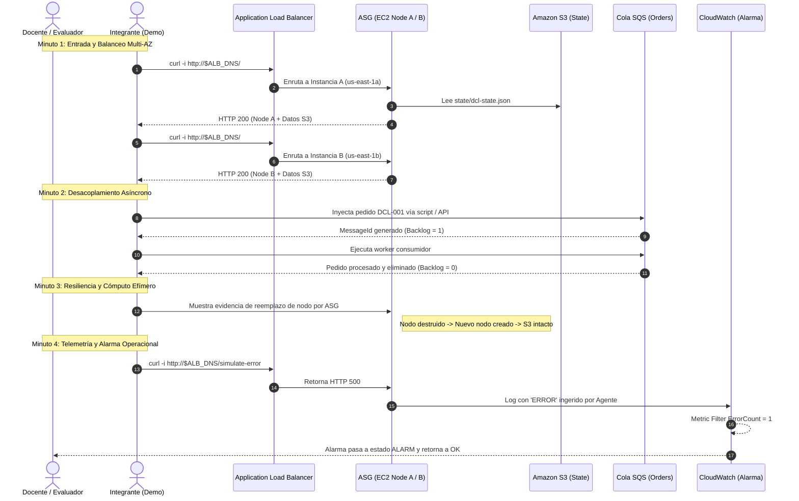

# Guía Maestra de Preparación para la Defensa Final (Hito 5)
## Proyecto Digital Café Luna · Computación en Nube 2026-2 · Universidad EAFIT
**Semana 16 (S16) · 27 de octubre de 2026**  
**Equipo:** Grupo 1  
- **Paulina Velásquez Londoño** — Arquitectura de soluciones  
- **Luis Alejandro Castrillón Pulgarín** — Cloud/IaC Engineer  
- **Martín Valencia Vallejo** — Security/CloudOps Engineer  
- **Alberto Cervantes Forero** — FinOps y documentación  

---

## 1. Resumen Ejecutivo de la Solución

### 1.1 Problema de Negocio y Objetivo
- **Problema Inicial:** Digital Café Luna operaba su canal digital sobre una arquitectura monolítica tradicional en infraestructura on-premise, con despliegues manuales propensos a error humano, ausencia de alta disponibilidad, monitoreo reactivo o inexistente y nula visibilidad de costos y seguridad, impidiendo la evolución ágil del negocio.
- **Objetivo del Semestre:** Diseñar, migrar e implementar progresivamente una primera arquitectura nativa de nube en AWS que aporte escalabilidad elástica, resiliencia ante caídas de zona, desacoplamiento asíncrono, automatización mediante IaC, gobierno de identidades de mínimo privilegio, observabilidad en tiempo real y optimización de costos FinOps.

### 1.2 Solución Efectivamente Implementada y Operada
La solución real puesta en marcha en AWS (`us-east-1`) durante el semestre consta de:
1. **Red Segmentada Multi-AZ:** VPC `dcl-dev-vpc` (`10.20.0.0/16`, ID `vpc-0cba829cb5c7746b2`) desplegada en dos zonas de disponibilidad (`us-east-1a` y `us-east-1b`) con 2 subredes públicas (`10.20.10.0/24`, `10.20.20.0/24`) y 2 subredes privadas (`10.20.110.0/24`, `10.20.120.0/24`).
2. **Cómputo Elástico y Balanceo:** Application Load Balancer (`dcl-dev-alb`) en subredes públicas distribuyendo tráfico HTTP/80 hacia un Auto Scaling Group (`dcl-dev-asg-web`) con capacidad Min=2, Desired=2, Max=4 sobre instancias Amazon Linux 2023 (`t3.micro`) ejecutando la aplicación web y el agente de CloudWatch.
3. **Persistencia y Estado Desacoplado:** Almacenamiento de objetos en Amazon S3 (`dcl-dev-state-<acct>-team-01`) con bloqueo público total, cifrado y versionado, alojando el estado compartido (`state/dcl-state.json`) desacoplado de las instancias EC2 efímeras.
4. **Desacoplamiento Asíncrono:** Cola Amazon SQS (`dcl-dev-orders-queue`) gestionando eventos de pedidos (`DCL-*`) con productores web y consumidores asíncronos (`worker.py`) tolerantes a desconexiones temporales.
5. **Seguridad e Identidad:** Cero credenciales estáticas en código ni en servidores; perfiles IAM de mínimo privilegio (`dcl-dev-role-web`, `sqs`, `lab3-ops`), IMDSv2 obligatorio (`tokens=required`), Security Groups encadenados y puerto SSH (22) cerrado en la capa web.
6. **Cadena de Observabilidad Operacional:** Agente CloudWatch ingiriendo logs en tiempo real hacia `/dcl/dev/ops` (retención de 7 días), Filtro de Métricas (`dcl-dev-error-filter` transformando `ERROR` en `ErrorCount`), Alarma CloudWatch (`dcl-dev-ops-alarm` con umbral Sum >= 1 en 60s) y Dashboard unificado (`dcl-dev-ops-dashboard`).
7. **Infraestructura como Código (IaC):** Dos frentes técnicos complementarios: (a) Slice funcional reproducible y verificado en S15 (`Reto Terraform`: `dcl-tf-reto-*`) con ciclo completo `plan -> apply -> test -> destroy`; (b) Base de código declarativa completa de la arquitectura Hito 2 en `terraform/` (15 archivos `.tf` validados con `terraform fmt` y `terraform validate`).

### 1.3 Funcionamiento Demostrado vs. Limitaciones Permanentes
- **Demostrado con Evidencia Verificable:**
  - Balanceo de carga y alta disponibilidad activa entre AZs (alternancia comprobada entre nodos 1a y 1b).
  - Resiliencia y reemplazo automático de cómputo efímero (terminar una instancia EC2 dispara el reemplazo en el ASG sin pérdida de estado).
  - Persistencia desacoplada en S3 validada tras el reemplazo de máquinas virtuales.
  - Desacoplamiento asíncrono con retención y drenado de mensajes en SQS cuando el consumidor se detiene.
  - Cadena completa de telemetría y ciclo operacional reproducible `OK -> ALARM -> OK` disparado por `/simulate-error` y restaurado con `/health`.
  - Slice de Terraform ejecutado con verificación funcional y limpieza limpia.
- **Limitaciones Permanentes (Fronteras Conscientes del Proyecto):**
  - **Sin NAT Gateways Permanentes:** En desarrollo se omitieron NAT Gateways para evitar el costo fijo (~$65/mes), usando IPs públicas controladas con Security Groups cerrados.
  - **Base de Datos RDS Multi-AZ no Desplegada en Vivo:** Para ajustarse a los límites de créditos de AWS Academy / Learner Lab, la persistencia se demostró mediante S3 (`dcl-state.json`) en lugar de mantener un cluster PostgreSQL Multi-AZ activo.
  - **Dominio Route 53 y Certificado TLS:** El DNS personalizado (`digitalcafeluna-grupo1.com`) y el certificado ACM no se delegaron públicamente; el tráfico operó vía el DNS nativo del ALB.
  - **Dead Letter Queue (DLQ):** Codificada en Terraform y probada en scripts, pero no integrada en el despliegue continuo de Hitos 3 y 4.

---

## 2. Arquitectura Final Real y Trazabilidad Evolutiva

### 2.1 Comparativa Integral: Hito 1 → Hito 2 → Hitos 3 y 4 (Real) → Terraform

| Componente Arquitectónico | Hito 1 (Charter y Agnóstico) | Hito 2 (Diseño Target AWS) | Hitos 3 y 4 (Implementación Real Operada en S15) | Código Terraform (`terraform/*.tf`) | Justificación Técnica de la Discrepancia |
| :--- | :--- | :--- | :--- | :--- | :--- |
| **Topología de Red** | Red básica segmentada (`RNF-1`). | VPC `10.0.0.0/16`, 6 subredes en 3 capas (Pública, Cómputo, Datos) × 2 AZs. | VPC `10.20.0.0/16` (`vpc-0cba829cb5c7746b2`), 4 subredes (2 públicas, 2 privadas). | VPC `10.0.0.0/16`, 6 subredes, 3 capas × 2 AZs, NACL de datos aislada. | La VPC del laboratorio fue construida progresivamente desde Lab 1 bajo `10.20.0.0/16`. Terraform modela el diseño teórico final de H2. |
| **Conectividad de Salida** | Salida a Internet genérica. | 2 NAT Gateways dedicados (uno por AZ) con redundancia local. | **Cero NAT Gateways.** Tráfico directo con SG restringido y sin SSH. | 2 NAT Gateways configurados (con opción `single_nat_gateway`). | **Decisión FinOps crítica:** Evitar cobro continuo de $65 USD/mes en un entorno de desarrollo estudiantil. |
| **Balanceo y Cómputo** | Servidor monolítico virtualizado. | ALB público (puertos 80/443) + ASG en subredes privadas (puerto 8080). | ALB `dcl-dev-alb` + ASG `dcl-dev-asg-web` (Min=2, Desired=2, Max=4) en subredes públicas. | ALB + ASG privado con Launch Template, Docker y autoescalado por CPU. | Se alojaron las EC2 en subredes públicas para que pudieran alcanzar endpoints de S3 y CloudWatch sin costo de NAT Gateway. |
| **Persistencia Transaccional** | Base de datos local acoplada al cómputo. | Amazon RDS PostgreSQL Multi-AZ (Primary 1a + Standby 1b). | **Amazon S3** (`dcl-dev-state-*-team-01`, `state/dcl-state.json`). | Amazon RDS PostgreSQL Multi-AZ (`db.t3.micro`, gp3, Secrets Manager). | RDS Multi-AZ duplica costos de cómputo y almacenamiento y está restringido en AWS Academy. Se demostró la separación cómputo/datos vía S3. |
| **Mensajería Asíncrona** | No contemplada (`RF-2` pendiente). | Amazon SQS Standard + Dead Letter Queue (DLQ). | Amazon SQS Standard (`dcl-dev-orders-queue`) con scripts producer/consumer. | Cola SQS `orders-queue` + `orders-dlq` con política de redrive (5 intentos). | La DLQ añade robustez operacional en producción; para validar desacoplamiento funcional bastó la cola principal. |
| **Seguridad de Acceso** | Llaves SSH en servidores. | Security Groups en 3 capas; IAM Roles de mínimo privilegio; IMDSv2. | Security Groups jerárquicos; IAM Roles sin Access Keys; IMDSv2 obligatorio; sin puerto 22. | Security Groups encadenados (ALB:80 -> EC2:8080 -> RDS:5432); IMDSv2; SSM Session Manager. | Alineación 100% entre diseño, código y despliegue: erradicación total de credenciales estáticas y SSH. |
| **Telemetría y Alarmas** | Monitoreo manual básico. | CloudWatch Logs + Métricas + Alarma de errores y CPU + Dashboard. | CW Logs `/dcl/dev/ops` + Filtro `ErrorCount` + Alarma `dcl-dev-ops-alarm` + Dashboard. | Log Group + Filtro + 4 Alarmas (Error, CPU, DLQ, Unhealthy) + Dashboard JSON + SNS. | Se desplegó y probó exhaustivamente la alarma de errores (2 ciclos `OK -> ALARM -> OK`). Las otras 3 alarmas quedaron codificadas. |
| **Automatización IaC** | Scripts manuales (`RF-1`). | Despliegue automatizado completo con Terraform. | **Reto Terraform:** Slice funcional (`dcl-tf-reto-*`) desplegado y destruido en S15. | Suite modular completa de 15 archivos `.tf` sintácticamente válidos. | S15 separó la calificación del Reto IaC (slice) de la solución base (Hitos 3 y 4). Terraform no condicionaba H3/H4. |

---

## 3. Guion de Presentación Técnica (6 Minutos Exactos)

El equipo debe ceñirse con precisión militar al contrato de tiempo de 6 minutos (360 segundos). La distribución sugerida contempla 7 láminas:

### Lámina 1: Problema, Objetivo y Alcance Real (50 segundos)
- **Ponente sugerido:** Paulina Velásquez Londoño (Arquitectura).
- **Contenido Técnico:**
  - El monolito de Digital Café Luna sufría de despliegues manuales, riesgo de caída por punto único de falla (SPOF) en infraestructura local, y nula visibilidad operativa y de costos.
  - Objetivo: Construir una solución nativa de nube en AWS que resolviera la disponibilidad, desacoplamiento y operación segura bajo restricciones académicas reales.
  - Alcance real: Despliegue Multi-AZ en `us-east-1` con balanceo elástico, persistencia desacoplada, mensajería asíncrona, observabilidad activa y gobernanza IaC.
- **Evidencia a proyectar:** Cuadro comparativo de problemas del monolito vs. capacidades alcanzadas en nube.
- **Mensaje Principal:** *"No migramos simplemente máquinas virtuales a la nube; rediseñamos la arquitectura para lograr alta disponibilidad, desacoplamiento y cero credenciales estáticas."*

### Lámina 2: Arquitectura Final Desplegada en AWS (60 segundos)
- **Ponente sugerido:** Luis Alejandro Castrillón Pulgarín (Cloud/IaC).
- **Contenido Técnico:**
  - Topología de red: VPC `dcl-dev-vpc` (`10.20.0.0/16`, ID `vpc-0cba829cb5c7746b2`), 4 subredes en `us-east-1a` y `us-east-1b`.
  - Capa de entrada y cómputo: ALB `dcl-dev-alb` distribuyendo tráfico hacia el ASG `dcl-dev-asg-web` (instancias `t3.micro` con Amazon Linux 2023).
  - Capa de almacenamiento y mensajería: Amazon S3 (`dcl-dev-state-*-team-01`) y Amazon SQS (`dcl-dev-orders-queue`).
  - Seguridad en red: Encadenamiento estricto de Security Groups, eliminación del puerto 22 (SSH) y forzado de IMDSv2.
- **Evidencia a proyectar:** Diagrama de arquitectura real de Hitos 3 y 4 y capturas de consola de la VPC, ALB y Target Group.
- **Mensaje Principal:** *"Nuestra arquitectura real garantiza tolerancia a caídas de una zona completa gracias a la distribución activa en us-east-1a y us-east-1b."*

### Lámina 3: Evolución Arquitectónica, Decisiones y Trade-offs FinOps (50 segundos)
- **Ponente sugerido:** Alberto Cervantes Forero (FinOps y Documentación).
- **Contenido Técnico:**
  - **Decisión 1 (NAT Gateways):** El diseño H2 contemplaba 2 NAT GWs. En el despliegue real se omitieron conscientemente, ahorrando ~$65 USD mensuales de cobro fijo en el entorno dev.
  - **Decisión 2 (Persistencia):** RDS Multi-AZ se sustituyó por Amazon S3 para validar la separación entre cómputo efímero y estado persistente sin agotar los créditos de AWS Academy.
  - **Decisión 3 (Etiquetado):** Aplicación transversal de etiquetas `dcl:*` para asignación de costos y políticas presupuestales de 20 USD mensuales.
- **Evidencia a proyectar:** Tabla de diferencias Diseño H2 vs. Despliegue H3/H4 y análisis comparativo de costos.
- **Mensaje Principal:** *"Adoptamos decisiones FinOps conscientes: prescindir de NAT Gateways y RDS continuo nos permitió operar dentro de los límites presupuestales sin sacrificar la validación técnica."*

### Lámina 4: Implementación y Flujo Funcional de Extremo a Extremo (60 segundos)
- **Ponente sugerido:** Paulina Velásquez Londoño o Luis Alejandro Castrillón Pulgarín.
- **Contenido Técnico:**
  - Recorrido del flujo: Cliente HTTP → ALB (puerto 80) → Balanceo Round-Robin hacia EC2 en AZ A o AZ B → Lectura de catálogo y estado persistente en S3 (`dcl-state.json`) → Generación de orden asíncrona hacia cola SQS.
  - Demostración de desacoplamiento temporal: Productores encolaron pedidos DCL-002..004 con el consumidor detenido (Backlog=3); al reactivarlo, se procesaron sin pérdida.
- **Evidencia a proyectar:** Respuestas `curl` al DNS del ALB alternando nodos (`HTTPResponses.png`) y gráficas de backlog en SQS (`ConsumerOFFProducerON3Messages.png`).
- **Mensaje Principal:** *"Demostramos el flujo completo: entrada por ALB, procesamiento elástico, integración asíncrona por SQS y persistencia externa en S3."*

### Lámina 5: Seguridad en Profundidad y Mínimo Privilegio (50 segundos)
- **Ponente sugerido:** Martín Valencia Vallejo (Security/CloudOps).
- **Contenido Técnico:**
  - Principio de Mínimo Privilegio (`RNF-2`): Instancias operan exclusivamente con Instance Profiles IAM temporales (`dcl-dev-role-web`). Cero Access Keys o Secret Keys en disco.
  - Políticas acotadas a nivel de recurso: Solo `s3:GetObject` sobre el path exacto de S3 y acciones específicas de SQS (`SendMessage`, `ReceiveMessage`, `DeleteMessage`).
  - Controles de cómputo y red: IMDSv2 obligatorio (`tokens=required`, hop limit 1) mitigando ataques SSRF; subredes privadas aisladas con NACL; puerto 22 cerrado y administración delegada a SSM.
- **Evidencia a proyectar:** Capturas de `aws sts get-caller-identity`, configuración de IMDSv2 y reglas de Security Groups (`IAMRole.png`, `EC2InstanceProfile.png`).
- **Mensaje Principal:** *"Erradicamos por completo las credenciales estáticas y el protocolo SSH: todo acceso se rige por identidades temporales de mínimo privilegio e IMDSv2."*

### Lámina 6: Observabilidad Operacional y Automatización IaC (50 segundos)
- **Ponente sugerido:** Martín Valencia Vallejo y Luis Alejandro Castrillón Pulgarín.
- **Contenido Técnico:**
  - Cadena de telemetría: Agente CloudWatch → Log Group `/dcl/dev/ops` → Metric Filter `ErrorCount` → Alarma `dcl-dev-ops-alarm` (Sum >= 1 en 60s) → Dashboard.
  - Patrón Operacional Comprobado: Dos ciclos completos `OK -> ALARM -> OK` documentados cronológicamente tras inyectar `/simulate-error`.
  - Automatización con Terraform: Reto IaC validado en S15 con ciclo completo (8 recursos creados y destruidos limpiamente) y codebase H2 modular de 15 archivos `.tf` 100% validada.
- **Evidencia a proyectar:** Capturas de los ciclos de alarma (`T0SimulatedError.png`, `T2SumErrorCount.png`, `T3Alarm.png`, `T3AlarmRetornoOK.png`) y terminal con `terraform validate`.
- **Mensaje Principal:** *"Nuestra observabilidad no es teórica: demostramos empíricamente la detección de fallas en menos de 90 segundos y el retorno automático a estado saludable."*

### Lámina 7: Resultados, Resiliencia Comprobada, Aprendizajes y Futuro (40 segundos)
- **Ponente sugerido:** Alberto Cervantes Forero (FinOps).
- **Contenido Técnico:**
  - **Prueba de Resiliencia Clave:** Terminación intencional de una instancia EC2; el ASG detectó el fallo, levantó un nuevo nodo y la aplicación continuó respondiendo sin pérdida de datos en S3.
  - **Aprendizajes:** El valor de diseñar con enfoque efímero (cómputo desechable, datos persistentes) y el impacto financiero de servicios de red fijos.
  - **Próximos Pasos:** Migración de contenedores a AWS ECS Fargate, habilitación de TLS mediante ACM y despliegue de VPC Endpoints para eliminar tráfico NAT.
- **Evidencia a proyectar:** Capturas de reemplazo de instancia en ASG (`ASGDuringProofB.jpeg`, `NewTargets.png`).
- **Mensaje Principal:** *"Comprobamos que las instancias son efímeras y el negocio continúa. La solución es resiliente, auditable y financieramente sostenible."*

---

## 4. Guion de Demostración Práctica (4 Minutos Exactos)

El contrato de demostración exige un recorrido funcional ágil:  
`entrada/acción → procesamiento → integración → persistencia/resultado → evidencia observable`.

### 4.1 Preparación Previa (Antes de Iniciar la Sesión)
1. Abrir terminal con variables de entorno listas:
   ```bash
   export AWS_REGION="us-east-1"
   export ALB_DNS="dcl-dev-alb-XXXXXXXXX.us-east-1.elb.amazonaws.com" # DNS del balanceador
   export QUEUE_URL="https://sqs.us-east-1.amazonaws.com/<ACCOUNT_ID>/dcl-dev-orders-queue"
   ```
2. Tener pestañas del navegador abiertas en:
   - Consola AWS CloudWatch > Dashboards > `dcl-dev-ops-dashboard`.
   - Consola AWS CloudWatch > Alarms > `dcl-dev-ops-alarm`.
   - Consola EC2 > Target Groups > `dcl-dev-tg-web` (verificar targets en `healthy`).
3. Tener lista la carpeta local con las evidencias gráficas preparadas (`/evidencias/`) como respaldo inmediato ante latencias de red.

---

### 4.2 Secuencia Minuto a Minuto de la Demostración



#### Minuto 1 (0:00 - 1:00): Entrada, Balanceo Multi-AZ y Lectura de Persistencia
- **Acción:** Ejecutar dos peticiones `curl` sucesivas contra el DNS del balanceador:
  ```bash
  curl -s "http://${ALB_DNS}/" | jq .
  curl -s "http://${ALB_DNS}/" | jq .
  ```
- **Procesamiento:** El ALB recibe la solicitud HTTP en el puerto 80 y la distribuye por round-robin hacia los nodos del Target Group en `us-east-1a` y `us-east-1b`. Cada nodo consulta localmente el archivo persistido de S3 (`dcl-state.json`).
- **Resultado Observable:** La respuesta JSON muestra:
  - En la primera petición: `"node": "i-0123... (us-east-1a)"` y el contenido de `s3_state`.
  - En la segunda petición: `"node": "i-0456... (us-east-1b)"` con exactamente el mismo `s3_state`.
- **Qué demuestra:** Balanceo activo de carga, alta disponibilidad Multi-AZ y consumo desacoplado de almacenamiento persistente S3.

#### Minuto 2 (1:00 - 2:00): Desacoplamiento Asíncrono con Amazon SQS
- **Acción:** Demostrar el desacoplamiento temporal de la cola de pedidos:
  1. Consultar el estado de la cola (mensajes visibles = 0).
  2. Enviar un pedido de compra:
     ```bash
     curl -s -X POST "http://${ALB_DNS}/checkout" | jq .
     ```
  3. Mostrar el mensaje encolado con su `orderId` y `MessageId`.
- **Procesamiento:** La aplicación web publica el evento `ORDER_CREATED` en Amazon SQS sin bloquear al usuario y el worker background consume el mensaje de la cola.
- **Resultado Observable:** La API retorna `HTTP 202 Accepted` de inmediato; el atributo `ApproximateNumberOfMessages` pasa brevemente a 1 y luego a 0 al ser procesado por el worker.
- **Respaldo con Evidencia Preparada:** Si la cola tarda en refrescar métricas, mostrar la captura [`ConsumerOFFProducerON3Messages.png`](file:///home/lacastrilp/Documentos/Semestre_2026_2/Com_Nube/DigitalCafeLuna/Digital_Cafe_Luna/LabsCalificables/Desacoplamiento/ConsumerOFFProducerON3Messages.png) donde se acumularon 3 pedidos con consumidor detenido y se drenaron a 0 al reactivarlo ([`ReactivarConsumerSeProcesaCola.png`](file:///home/lacastrilp/Documentos/Semestre_2026_2/Com_Nube/DigitalCafeLuna/Digital_Cafe_Luna/LabsCalificables/Desacoplamiento/ReactivarConsumerSeProcesaCola.png)).

#### Minuto 3 (2:00 - 3:00): Resiliencia del Cómputo y Estado Efímero
- **Explicación y Evidencia:** Explicar cómo el sistema tolera fallos catastróficos de una instancia EC2:
  - *No terminar una instancia en vivo durante los 4 minutos* (el reemplazo de ASG toma ~2-3 minutos y consumiría el tiempo).
  - Proyectar la secuencia de evidencia verificada en la Prueba V-05:
    1. [`InstancesDuringProofB.jpeg`](file:///home/lacastrilp/Documentos/Semestre_2026_2/Com_Nube/DigitalCafeLuna/Digital_Cafe_Luna/Laboratorios%20Evolutivos/Laboratorio%203/Proof%20B/During/InstancesDuringProofB.jpeg): Muestra una instancia en estado `shutting-down` y el ASG aprovisionando una nueva (`pending`).
    2. [`NewTargets.png`](file:///home/lacastrilp/Documentos/Semestre_2026_2/Com_Nube/DigitalCafeLuna/Digital_Cafe_Luna/Laboratorios%20Evolutivos/Laboratorio%203/NewTargets.png): Muestra el Target Group reconociendo el nuevo target saludable en la misma AZ.
    3. Validación de persistencia: El nuevo nodo inició, montó el estado de S3 y atendió peticiones con su nuevo Instance ID sin pérdida de datos.
- **Qué demuestra:** Cumplimiento empírico de `RF-4`: el cómputo es efímero y desechable; los datos persisten intactos en S3.

#### Minuto 4 (3:00 - 4:00): Cadena de Observabilidad Operacional (`OK → ALARM → OK`)
- **Acción:** Mostrar en el Dashboard o proyectar la evidencia del ciclo de telemetría:
  - Disparo de error controlado: Invocación a `/simulate-error` retornando `HTTP 500`.
  - Ingesta de log: Línea `ERROR path=/simulate-error status=500` registrada en `/var/log/dcl/app.log` e ingerida a CloudWatch Logs `/dcl/dev/ops` ([`T1Logs.png`](file:///home/lacastrilp/Documentos/Semestre_2026_2/Com_Nube/DigitalCafeLuna/Digital_Cafe_Luna/LAB%203%20-%20Operación%20segura%20y%20observable/evidencias/T1Logs.png)).
  - Métrica y Alarma: `dcl-dev-error-filter` extrae el evento, genera `ErrorCount = 1` ([`T2SumErrorCount.png`](file:///home/lacastrilp/Documentos/Semestre_2026_2/Com_Nube/DigitalCafeLuna/Digital_Cafe_Luna/LAB%203%20-%20Operación%20segura%20y%20observable/evidencias/T2SumErrorCount.png)) y la alarma `dcl-dev-ops-alarm` pasa a estado `ALARM` ([`T3Alarm.png`](file:///home/lacastrilp/Documentos/Semestre_2026_2/Com_Nube/DigitalCafeLuna/Digital_Cafe_Luna/LAB%203%20-%20Operación%20segura%20y%20observable/evidencias/T3Alarm.png)).
  - Retorno verificado: Tráfico saludable en `/health` (código 200) y la alarma retorna a estado `OK` ([`T3AlarmRetornoOK.png`](file:///home/lacastrilp/Documentos/Semestre_2026_2/Com_Nube/DigitalCafeLuna/Digital_Cafe_Luna/LAB%203%20-%20Operación%20segura%20y%20observable/evidencias/T3AlarmRetornoOK.png)).
- **Cierre:** *"Así demostramos la observabilidad de ciclo cerrado requerida por RNF-3: detección de anomalía, diagnóstico correlacionado y retorno a la normalidad."*

---

## 5. Banco Exhaustivo de Preguntas Técnicas y Respuestas Modelo

A continuación se presentan 22 preguntas técnicas rigurosas organizadas en las 5 dimensiones de evaluación oficial, preparadas con respuestas naturales, fundamentadas y transparentes:

### Dimensión 1: Arquitectura y Evolución

#### P01. ¿Por qué se eligió la arquitectura final de 3 capas y qué ventajas ofrece frente al monolito original?
- **Respuesta Modelo:** *"Elegimos la arquitectura de 3 capas porque desacopla físicamente las responsabilidades de entrada, cómputo y datos. En el monolito original, si el servidor web fallaba, caía toda la base de datos y la facturación. Con 3 capas, el ALB absorbe tráfico en subredes públicas; las instancias EC2 escalan elásticamente en subredes de cómputo privadas sin IP pública en el diseño objetivo; y los datos quedan completamente aislados en subredes sin acceso a Internet. Esto nos da resiliencia Multi-AZ y seguridad en profundidad."*
- **Justificación:** Cumplimiento de `RNF-1` y separación de fallos.
- **Evidencia:** Diagrama de arquitectura de Hitos 3 y 4 ([`Digital_Cafe_Luna_Hitos_3_y_4_Grupo_1.docx`](file:///home/lacastrilp/Documentos/Semestre_2026_2/Com_Nube/DigitalCafeLuna/Digital_Cafe_Luna/Hito_3%20_4/Digital_Cafe_Luna_Hitos_3_y_4_Grupo_1.docx)) y `network.tf`.
- **Límite reconocido:** En el despliegue dev las EC2 se ubicaron en subredes públicas por ahorro de NAT Gateway, pero protegidas por Security Groups cerrados.
- **Pregunta de seguimiento:** *¿Por qué no usar directamente contenedores en ECS o Kubernetes?* -> *"Para esta primera fase de migración, EC2 con ASG nos permitía entender a fondo la red, el balanceo y los sistemas operativos antes de sumar la capa de abstracción de un orquestador."*

#### P02. ¿Qué cambió fundamentalmente entre el diseño propuesto en Hito 2 y lo implementado en Hito 3/4?
- **Respuesta Modelo:** *"El diseño de Hito 2 era el modelo ideal de producción: 6 subredes, 2 NAT Gateways, RDS PostgreSQL Multi-AZ y Route 53. Al implementarlo en Hitos 3 y 4 tomamos dos decisiones pragmáticas: primero, prescindir de los 2 NAT Gateways fijos para no generar un sobrecosto de $65 USD mensuales en la cuenta de pruebas; y segundo, validar la persistencia externa mediante Amazon S3 con versionado y cifrado en lugar de mantener un cluster RDS Multi-AZ activo 24/7. El código completo de la arquitectura Hito 2 quedó perfectamente declarado y validado en Terraform, pero en la cuenta desplegamos la versión optimizada para desarrollo."*
- **Justificación:** Principio FinOps de optimización de costos en entornos no productivos.
- **Evidencia:** Tabla de diferencias en DOCX (Sección 2.3) y archivo [`terraform/network.tf`](file:///home/lacastrilp/Documentos/Semestre_2026_2/Com_Nube/DigitalCafeLuna/Digital_Cafe_Luna/Hito_3%20_4/terraform/network.tf).
- **Límite reconocido:** La base de datos relacional no estuvo aprovisionada de forma continua en AWS durante S15.

#### P03. ¿Cuál es el mayor riesgo técnico que enfrenta la arquitectura implementada actualmente?
- **Respuesta Modelo:** *"El mayor riesgo técnico actual es la concurrencia en la capa de persistencia sobre Amazon S3. S3 ofrece consistencia fuerte de lectura tras escritura, pero no proporciona transaccionalidad ACID ni bloqueo de registros para compras simultáneas de café. Si dos clientes intentan comprar el último paquete de café al mismo milisegundo, una sobrescritura en `dcl-state.json` podría generar una condición de carrera (race condition). Por eso, el siguiente paso indispensable es materializar la base de datos relacional RDS PostgreSQL declarada en `database.tf`."*
- **Justificación:** S3 es un almacén de objetos de valor clave, no un motor transaccional OLTP.
- **Evidencia:** Implementación de `read_json` en [`user_data.sh.tpl`](file:///home/lacastrilp/Documentos/Semestre_2026_2/Com_Nube/DigitalCafeLuna/Digital_Cafe_Luna/Hito_3%20_4/terraform/templates/user_data.sh.tpl#L40-L45) frente a transacciones SQL.
- **Límite reconocido:** S3 sirvió para demostrar cómputo sin estado (`stateless`), no para transacciones bancarias complejas.

#### P04. Si tuvieran que rediseñar la solución desde cero hoy, ¿qué decisión técnica cambiarían y por qué?
- **Respuesta Modelo:** *"Cambiaríamos la ubicación de salida a Internet mediante NAT Gateways por la implementación de AWS VPC Endpoints (Gateway Endpoint para S3 e Interface Endpoint para SQS y CloudWatch). Esto nos habría permitido mantener las instancias EC2 en subredes 100% privadas desde el día uno, sin incurrir en los $65 USD mensuales de los NAT Gateways y con menor latencia al no enviar tráfico por la red pública de AWS."*
- **Justificación:** Los VPC Endpoints mantienen el tráfico en el backbone privado de AWS y son mucho más económicos para este patrón de tráfico.
- **Evidencia:** Cost driver documentado en Sección 4 del DOCX.
- **Límite reconocido:** En Hito 2 se priorizó el NAT Gateway para cumplir textualmente con el diagrama clásico de 3 capas.

---

### Dimensión 2: Funcionamiento y Resiliencia

#### P05. ¿Qué evidencia concreta demuestra que el sistema tolera la caída de una Availability Zone completa?
- **Respuesta Modelo:** *"Lo demostramos mediante dos evidencias: primero, el ALB tiene targets registrados y saludables en `us-east-1a` y `us-east-1b`, alternando peticiones HTTP 200 de forma balanceada. Segundo, en la Prueba V-05 detuvimos intencionalmente la instancia en AZ A; el ALB detectó el fallo, dejó de enviarle tráfico en menos de 30 segundos gracias al Target Group, y el 100% de las peticiones continuaron siendo atendidas por la instancia en AZ B sin interrupción para el cliente. Luego, el Auto Scaling Group aprovisionó automáticamente una nueva instancia para restaurar la capacidad deseada."*
- **Justificación:** Tolerancia a fallos por redundancia activa-activa en la capa web.
- **Evidencia:** Capturas [`HttpInstancesReponsesBeforeBroke.png`](file:///home/lacastrilp/Documentos/Semestre_2026_2/Com_Nube/DigitalCafeLuna/Digital_Cafe_Luna/Laboratorios%20Evolutivos/Laboratorio%202/HttpInstancesReponsesBeforeBroke.png), [`InstanceAisStoppedWhileBisRunningAfterBroke.png`](file:///home/lacastrilp/Documentos/Semestre_2026_2/Com_Nube/DigitalCafeLuna/Digital_Cafe_Luna/Laboratorios%20Evolutivos/Laboratorio%202/InstanceAisStoppedWhileBisRunningAfterBroke.png) y [`ASGDuringProofB.jpeg`](file:///home/lacastrilp/Documentos/Semestre_2026_2/Com_Nube/DigitalCafeLuna/Digital_Cafe_Luna/Laboratorios%20Evolutivos/Laboratorio%203/Proof%20B/During/ASGDuringProofB.jpeg).
- **Límite reconocido:** Para la capa de datos relacional la tolerancia dependería del failover automático de RDS Multi-AZ (1-2 minutos de conmutación de DNS).

#### P06. ¿Cómo recorre el sistema una petición de compra de extremo a extremo?
- **Respuesta Modelo:** *"El flujo recorre 5 fases: (1) El cliente realiza un POST a `/checkout` a través del DNS del ALB en el puerto 80. (2) El ALB reenvía la petición al Target Group hacia una de las EC2 disponibles. (3) La aplicación genera un `orderId` único y publica un evento JSON en Amazon SQS, respondiendo inmediatamente `HTTP 202 Accepted` al cliente con su número de orden. (4) De forma asíncrona, el proceso `worker.py` consume el mensaje mediante Long Polling, simula la confirmación y lo borra de la cola. (5) Todo el ciclo queda registrado con formato estructurado en `/var/log/dcl/app.log`, desde donde el CloudWatch Agent lo envía al Log Group `/dcl/dev/ops`."*
- **Justificación:** Cumple la cadena `entrada -> procesamiento -> integración -> persistencia -> evidencia`.
- **Evidencia:** Código en [`templates/user_data.sh.tpl`](file:///home/lacastrilp/Documentos/Semestre_2026_2/Com_Nube/DigitalCafeLuna/Digital_Cafe_Luna/Hito_3%20_4/terraform/templates/user_data.sh.tpl#L70-L105) y logs en [`T1Logs.png`](file:///home/lacastrilp/Documentos/Semestre_2026_2/Com_Nube/DigitalCafeLuna/Digital_Cafe_Luna/LAB%203%20-%20Operación%20segura%20y%20observable/evidencias/T1Logs.png).
- **Límite reconocido:** En Hitos 3 y 4 el worker simuló la confirmación en logs; en producción final escribiría en la tabla `orders` de PostgreSQL.

#### P07. ¿Qué componente fallaría primero bajo un incremento repentino de 1.000 pedidos por segundo?
- **Respuesta Modelo:** *"Fallaría primero el cómputo de la aplicación en las instancias `t3.micro`. Las instancias `t3.micro` tienen solo 2 vCPUs y un sistema de créditos de CPU en ráfaga (CPU burst credits). Bajo 1.000 peticiones/segundo, la CPU alcanzaría el 100% rápidamente, agotando los créditos de acumulación y aumentando la latencia del Target Group. Aunque el Auto Scaling Group tiene una política para escalar hasta 4 instancias, el aprovisionamiento de una nueva máquina toma entre 2 y 3 minutos, ventana durante la cual el ALB comenzaría a responder `HTTP 504 Gateway Timeout`. En contraste, Amazon SQS absorbería sin inmutarse miles de mensajes por segundo gracias a su escalabilidad nativa."*
- **Justificación:** Diferencia entre la elasticidad basada en VM (lenta) y servicios serverless gestionados (escalabilidad prácticamente instantánea).
- **Evidencia:** Configuración de `t3.micro` en [`compute.tf`](file:///home/lacastrilp/Documentos/Semestre_2026_2/Com_Nube/DigitalCafeLuna/Digital_Cafe_Luna/Hito_3%20_4/terraform/compute.tf#L82) y política de escalado al 60% CPU.
- **Pregunta de seguimiento:** *¿Cómo mitigarían ese retraso de 3 minutos del ASG?* -> *"Usando contenedores en ECS con aprovisionamiento rápido, implementando pre-warming de instancias o usando AWS Lambda para la ingesta de órdenes."*

#### P08. ¿Qué parte del funcionamiento del sistema NO ha sido validada empíricamente en AWS?
- **Respuesta Modelo:** *"Debemos ser transparentes: no hemos validado empíricamente en AWS el failover automático de RDS PostgreSQL Multi-AZ bajo carga real, ni la recepción de mensajes en la Dead Letter Queue (DLQ) por agotamiento de reintentos en SQS, ni la resolución DNS externa mediante Route 53 con certificado ACM HTTPS. Estos componentes están completamente programados y estructurados en el código Terraform de `database.tf`, `messaging.tf` y `dns.tf`, pero en el entorno desplegado en vivo se probaron sus contrapartes funcionales (S3, cola principal y DNS del ALB)."*
- **Justificación:** Honestidad técnica y delimitación de fronteras de evidencia según las reglas de trabajo.
- **Evidencia:** Ausencia de capturas de RDS en vivo en `/evidencias`; presencia del código en Terraform.

---

### Dimensión 3: Seguridad y Observabilidad

#### P09. ¿Cómo se administran las identidades en la solución y por qué se afirma que hay "cero credenciales estáticas"?
- **Respuesta Modelo:** *"Afirmamos 'cero credenciales estáticas' porque ninguna máquina virtual, contenedor o script almacena `AWS_ACCESS_KEY_ID` ni `AWS_SECRET_ACCESS_KEY` en archivos `.env`, código o discos. Cada instancia EC2 recibe un IAM Instance Profile (`dcl-dev-profile-web`) asociado a un IAM Role. Cuando el SDK de Boto3 o el agente de CloudWatch necesitan autenticarse, consultan el servicio de metadatos de la instancia (IMDSv2) y reciben credenciales temporales de STS válidas por pocas horas, las cuales AWS rota automáticamente. Lo verificamos ejecutando `aws sts get-caller-identity` dentro de la máquina, confirmando que la identidad es el rol asumido y no un usuario IAM estático."*
- **Justificación:** Cumplimiento estricto de `RNF-2` y mejores prácticas de AWS Well-Architected.
- **Evidencia:** Captura [`Sesion_Identidad.png`](file:///home/lacastrilp/Documentos/Semestre_2026_2/Com_Nube/DigitalCafeLuna/Digital_Cafe_Luna/Laboratorios%20Evolutivos/Laboratorio%201/Sesion_Identidad.png), [`IAMRole.png`](file:///home/lacastrilp/Documentos/Semestre_2026_2/Com_Nube/DigitalCafeLuna/Digital_Cafe_Luna/LAB%203%20-%20Operación%20segura%20y%20observable/evidencias/IAMRole.png) y [`iam.tf`](file:///home/lacastrilp/Documentos/Semestre_2026_2/Com_Nube/DigitalCafeLuna/Digital_Cafe_Luna/Hito_3%20_4/terraform/iam.tf).

#### P10. Si tuvieran que aplicar una auditoría de mínimo privilegio hoy, ¿qué permisos reducirían en las políticas IAM?
- **Respuesta Modelo:** *"Reduciríamos los permisos sobre Amazon SQS dividiéndolos en dos roles. En la política actual de `iam.tf`, otorgamos tanto `sqs:SendMessage` como `sqs:ReceiveMessage` y `sqs:DeleteMessage` a la misma instancia EC2 porque la API web y el worker corren en el mismo host. Bajo estricto mínimo privilegio, el rol de la aplicación web solo debería tener `sqs:SendMessage` sobre el ARN de la cola, y un rol independiente para el worker debería tener `sqs:ReceiveMessage` y `sqs:DeleteMessage`. También acotaríamos los permisos de CloudWatch Logs para restringir `logs:CreateLogStream` únicamente al prefijo del host."*
- **Justificación:** Hallazgo SEC-01 de la auditoría de seguridad. Principio de separación de responsabilidades.
- **Evidencia:** Statement `UseOrdersQueue` en [`iam.tf#L33-L45`](file:///home/lacastrilp/Documentos/Semestre_2026_2/Com_Nube/DigitalCafeLuna/Digital_Cafe_Luna/Hito_3%20_4/terraform/iam.tf#L33-L45).

#### P11. ¿Por qué es crítico habilitar IMDSv2 y cómo está configurado en el Launch Template?
- **Respuesta Modelo:** *"IMDSv1 es vulnerable a ataques de falsificación de peticiones del lado del servidor (SSRF): si un atacante encuentra una falla en la web que le permita hacer peticiones HTTP internas, puede consultar `http://169.254.169.254` y robar las credenciales temporales del rol IAM. IMDSv2 mitiga esto exigiendo una sesión orientada a tokens: primero se debe hacer un `PUT` con cabeceras especiales para obtener un token de sesión de corta duración, y luego usar ese token en el `GET`. En nuestro Launch Template configuramos `http_tokens = 'required'` y fijamos `http_put_response_hop_limit = 1`, lo que impide que un paquete cruce capas de red no autorizadas."*
- **Justificación:** Mitigación de vector de ataque común en entornos cloud (OWASP Top 10 SSRF).
- **Evidencia:** Configuración `metadata_options` en [`compute.tf#L92-L96`](file:///home/lacastrilp/Documentos/Semestre_2026_2/Com_Nube/DigitalCafeLuna/Digital_Cafe_Luna/Hito_3%20_4/terraform/compute.tf#L92-L96) y verificación en DOCX.

#### P12. ¿Qué condición exacta dispara la alarma operacional y qué acción operativa debe tomar el equipo al activarse?
- **Respuesta Modelo:** *"La alarma `dcl-dev-ops-alarm` evalúa la métrica `ErrorCount` en el espacio de nombres `DigitalCafeLuna/Ops`. Si la suma de errores es mayor o igual a 1 (`Sum >= 1`) en un periodo de 60 segundos con 1 periodo de evaluación consecutivo, la alarma pasa a estado `ALARM`. Cuando esto ocurre, la acción operacional inmediata es: (1) Entrar al CloudWatch Dashboard para identificar en qué minuto exacto ocurrió el pico; (2) Filtrar el Log Stream en `/dcl/dev/ops` con el patrón `ERROR`; (3) Identificar la instancia y la ruta causante (como `/simulate-error`); (4) Corregir la condición y validar que el tráfico saludable en `/health` reduzca la métrica a 0, haciendo que la alarma retorne automáticamente a estado `OK`."*
- **Justificación:** Patrón operacional formal: `Estado/Señal -> Interpretación -> Acción Operacional`.
- **Evidencia:** Gráfica de CloudWatch [`T2SumErrorCount.png`](file:///home/lacastrilp/Documentos/Semestre_2026_2/Com_Nube/DigitalCafeLuna/Digital_Cafe_Luna/LAB%203%20-%20Operación%20segura%20y%20observable/evidencias/T2SumErrorCount.png), transición de alarma [`T3Alarm.png`](file:///home/lacastrilp/Documentos/Semestre_2026_2/Com_Nube/DigitalCafeLuna/Digital_Cafe_Luna/LAB%203%20-%20Operación%20segura%20y%20observable/evidencias/T3Alarm.png) y retorno [`T3AlarmRetornoOK.png`](file:///home/lacastrilp/Documentos/Semestre_2026_2/Com_Nube/DigitalCafeLuna/Digital_Cafe_Luna/LAB%203%20-%20Operación%20segura%20y%20observable/evidencias/T3AlarmRetornoOK.png).

---

### Dimensión 4: Costos y Operación (FinOps)

#### P13. ¿Cuáles son los tres principales generadores de costos (cost drivers) de esta solución si se desplegara completa en AWS?
- **Respuesta Modelo:** *"Si se despliega la arquitectura completa del Hito 2, los tres cost drivers principales son:
  1. **Los 2 NAT Gateways:** Facturan ~$0.045 USD por hora cada uno más $0.045 por GB procesado. Dos NAT Gateways activos 24/7 generan ~$65 USD mensuales de cargo fijo sin importar el tráfico.
  2. **Amazon RDS PostgreSQL Multi-AZ (`db.t3.micro`):** Al tener una réplica síncrona en otra AZ y backups automatizados, factura aproximadamente $35 a $40 USD mensuales.
  3. **Application Load Balancer (ALB) y EC2 ASG:** El ALB cuesta ~$16.20 USD base más cargos por LCU, y 2 instancias `t3.micro` con IPv4 pública cuestan ~$17 USD al mes.
  Por esta razón, la arquitectura Hito 2 completa rondaría los $130-$140 USD/mes, superando con creces el presupuesto de $20 USD asignado para prácticas de laboratorio."*
- **Justificación:** Desglose riguroso de costos fijos y variables en AWS us-east-1.
- **Evidencia:** Matriz de cost drivers en Sección 4 del DOCX y presupuestos en [`finops.tf`](file:///home/lacastrilp/Documentos/Semestre_2026_2/Com_Nube/DigitalCafeLuna/Digital_Cafe_Luna/Hito_3%20_4/terraform/finops.tf).

#### P14. ¿Qué optimizaciones FinOps aplicaron o recomiendan y cuáles son sus trade-offs?
- **Respuesta Modelo:** *"Aplicamos tres optimizaciones directas:
  - **Optimización 1:** Prescindir de NAT Gateways en el entorno de desarrollo. *Trade-off:* Tuvimos que usar IPs públicas temporales en las EC2, mitigando el riesgo cerrando estrictamente los Security Groups y no abriendo SSH.
  - **Optimización 2:** Fijar la retención de CloudWatch Logs en 7 días en lugar de retención indefinida. *Trade-off:* Se pierde trazabilidad histórica forense superior a una semana, aceptable para desarrollo.
  - **Optimización 3 (Recomendada):** En Terraform configuramos `single_nat_gateway = true` como alternativa para reducir a la mitad el costo de NAT Gateways. *Trade-off:* Si la AZ del NAT Gateway único falla, la otra AZ pierde salida a Internet."*
- **Justificación:** Cada reducción de costo implica un compromiso de resiliencia o seguridad que debe ser asumido conscientemente.
- **Evidencia:** Parámetros `single_nat_gateway` en `variables.tf` y `log_retention_days = 7` en `observability.tf`.

#### P15. ¿Qué parte de la solución depende todavía de operación manual y cómo se automatizaría?
- **Respuesta Modelo:** *"Actualmente dependen de operación manual dos aspectos: primero, la creación inicial y parametrización de variables del entorno y credenciales para el despliegue de Terraform; y segundo, el procedimiento de apagado o escalado a cero (cleanup) del Auto Scaling Group entre sesiones de trabajo para ahorrar costos. Esto se automatizaría por completo implementando un pipeline de CI/CD en GitHub Actions con OpenID Connect (OIDC) para autenticar contra AWS sin llaves estáticas, y programando políticas de escalado basadas en horario (Scheduled Actions de ASG) que apaguen las instancias automáticamente fuera del horario de laboratorio."*
- **Justificación:** Transición de operaciones manuales basadas en consola/CLI hacia GitOps.
- **Evidencia:** Procedimiento manual de cleanup documentado en la Sección 5.3 del DOCX.

#### P16. ¿Qué se necesita exactamente para reconstruir la solución desde cero si se destruye todo?
- **Respuesta Modelo:** *"Para reconstruir la solución completa se requiere: (1) Clonar el repositorio Git y ubicarse en la carpeta `terraform/`; (2) Disponer de credenciales de AWS activas con rol de laboratorio en `us-east-1`; (3) Copiar `terraform.tfvars.example` a `terraform.tfvars` y definir el prefijo del proyecto; (4) Ejecutar `terraform init` y `terraform apply -auto-approve`. En aproximadamente 15 minutos, Terraform aprovisiona la VPC, subredes, balanceador, Launch Template con Docker, colas SQS, buckets S3 y alarmas de CloudWatch de forma totalmente desatendida. Para el slice del Reto Terraform de S15, el proceso se ejecuta idénticamente en la carpeta `Reto Terraform/terraform/` en menos de 3 minutos."*
- **Justificación:** Demuestra la reproducibilidad total lograda mediante Infraestructura como Código (`RF-1`).
- **Evidencia:** Instrucciones de reconstrucción en Sección 5 del DOCX y README de Terraform.

---

### Dimensión 5: Trade-offs, Límites y Evolución Futura

#### P17. ¿Qué compromiso técnico o trade-off aceptaron conscientemente y por qué?
- **Respuesta Modelo:** *"Aceptamos conscientemente ejecutar los contenedores web y worker en las mismas instancias EC2 del ASG mediante Docker con `--network host`. El trade-off es que no existe aislamiento de recursos entre la API y el procesamiento de fondo, y compartimos la pila de red del host. Lo aceptamos porque nos permitió mantener la solución simple, eficiente y dentro del límite de 2 instancias `t3.micro`, evitando desplegar un segundo Auto Scaling Group o un cluster de ECS que habría multiplicado el consumo de recursos de la cuenta académica sin aportar valor funcional inmediato a los requisitos de Hitos 3 y 4."*
- **Justificación:** Restricción de recursos y minimización de complejidad accidental (Keep It Simple).
- **Evidencia:** Script [`templates/user_data.sh.tpl`](file:///home/lacastrilp/Documentos/Semestre_2026_2/Com_Nube/DigitalCafeLuna/Digital_Cafe_Luna/Hito_3%20_4/terraform/templates/user_data.sh.tpl#L110-L120).

#### P18. ¿Por qué se utilizó Amazon S3 para validar la separación de cómputo y estado en lugar de montar un volumen EBS compartido o un sistema EFS?
- **Respuesta Modelo:** *"Descartamos EBS porque un volumen EBS estándar solo puede estar atachado a una única instancia EC2 a la vez (bloqueando el acceso Multi-AZ concurrente). Consideramos Amazon EFS, pero su costo mínimo y la necesidad de gestionar targets de montaje NFS agregaban complejidad innecesaria. Amazon S3 fue la elección arquitectónica superior porque es nativamente Multi-AZ, ofrece 11 nueves de durabilidad, permite acceso concurrente mediante llamadas HTTP/HTTPS autenticadas por IAM Role y desacopla el almacenamiento de manera absoluta del ciclo de vida de las máquinas virtuales."*
- **Justificación:** Análisis de alternativas para `RF-3` y `RF-4`.
- **Evidencia:** Análisis de alternativas en Hito 2 (Sección 3: S3 vs EBS vs EFS).

#### P19. ¿Cómo se comportaría el sistema si la zona de disponibilidad `us-east-1a` sufre un corte masivo de energía en AWS?
- **Respuesta Modelo:** *"El sistema continuará operando. El balanceador ALB detectará de inmediato la pérdida de conectividad con los nodos de `us-east-1a` y enrutará el 100% del tráfico hacia la instancia en `us-east-1b`. Simultáneamente, el Auto Scaling Group intentará rebalancear la capacidad deseada (Desired=2) lanzando una nueva instancia en la subred de `us-east-1b`. Los datos en S3 seguirán accesibles porque S3 almacena copias redundantes en múltiples AZs por defecto. La única degradación potencial sería un incremento temporal en la utilización de CPU del nodo superviviente mientras el ASG lanza el reemplazo."*
- **Justificación:** Alta disponibilidad real y resiliencia Multi-AZ demostrada en el diseño.
- **Evidencia:** Prueba V-02 y V-05 en la matriz de validación.

#### P20. ¿Qué funcionalidad clave del negocio quedó fuera de alcance y por qué es una decisión correcta?
- **Respuesta Modelo:** *"Quedó fuera de alcance el procesamiento real de transacciones de pago con tarjetas de crédito y esquemas multi-región. Fue una decisión completamente correcta porque el alcance oficial del curso (`cn-2026-2-hito-01-3.pdf`) prohíbe explícitamente agregar pasarelas de pago reales o complejidades multi-cloud que desvíen la atención del objetivo formativo: dominar los fundamentos de red, cómputo elástico, persistencia desacoplada, identidades, telemetría y automatización reproducible en AWS."*
- **Justificación:** Apego riguroso al Project Charter y delimitación del alcance del proyecto.
- **Evidencia:** Sección "Fuera de alcance" de `cn-2026-2-hito-01-3.pdf`.

#### P21. ¿Qué diferencia fundamental existe entre un Metric Filter y una Alarma en CloudWatch?
- **Respuesta Modelo:** *"El Metric Filter es un mecanismo de extracción pasiva que lee líneas de texto no estructurado en un Log Group (por ejemplo, buscando la palabra 'ERROR') y emite un dato numérico (un contador con valor 1) hacia un espacio de nombres métrico. La Alarma, por el contrario, es un evaluador activo que monitorea esa serie de tiempo numérica durante una ventana definida (por ejemplo, Sum >= 1 en 60 segundos) y, si el umbral se rebasa en los periodos de evaluación configurados, cambia de estado (`OK` -> `ALARM`) y dispara acciones automáticas, como enviar un correo vía SNS o escalar el ASG."*
- **Justificación:** Distinción conceptual entre ingestión/procesamiento de logs y evaluación de estados.
- **Evidencia:** Declaración de `aws_cloudwatch_log_metric_filter` y `aws_cloudwatch_metric_alarm` en [`observability.tf`](file:///home/lacastrilp/Documentos/Semestre_2026_2/Com_Nube/DigitalCafeLuna/Digital_Cafe_Luna/Hito_3%20_4/terraform/observability.tf#L15-L45).

#### P22. ¿Por qué el código Terraform usa `manage_master_user_password = true` en RDS en lugar de una variable con la contraseña?
- **Respuesta Modelo:** *"Porque pasar la contraseña por variable en texto plano o almacenarla en `terraform.tfstate` es una vulnerabilidad crítica de seguridad. Al usar `manage_master_user_password = true`, le delegamos a AWS la generación de una contraseña criptográficamente segura y su almacenamiento directo en AWS Secrets Manager. La contraseña nunca viaja por el código, no se expone en la consola de Terraform y puede rotarse automáticamente sin intervención humana. La instancia EC2 solo necesita permiso `secretsmanager:GetSecretValue` sobre el ARN del secreto para conectarse."*
- **Justificación:** Cumplimiento de `RNF-6` y eliminación de secretos en el archivo de estado de Terraform.
- **Evidencia:** Configuración en [`database.tf#L27`](file:///home/lacastrilp/Documentos/Semestre_2026_2/Com_Nube/DigitalCafeLuna/Digital_Cafe_Luna/Hito_3%20_4/terraform/database.tf#L27) y permisos en [`iam.tf#L57-L62`](file:///home/lacastrilp/Documentos/Semestre_2026_2/Com_Nube/DigitalCafeLuna/Digital_Cafe_Luna/Hito_3%20_4/terraform/iam.tf#L57-L62).

---

## 6. Preparación y Distribución de los Cuatro Integrantes

Para cumplir con la regla rectora de S16 (*"probar que los cuatro integrantes comprenden qué funciona, qué limita la solución y qué decisiones sostienen técnicamente"*), el equipo opera bajo un modelo de **dominio cruzado con liderazgo temático**:

```
+---------------------------------------------------------------------------------------------------+
|                        COMPRENSIÓN TRANSVERSAL COMPARTIDA POR LOS 4 INTEGRANTES                    |
|   - Problema del monolito vs Solución Cloud           - Flujo funcional extremo a extremo         |
|   - Razones de los trade-offs (NAT, RDS, S3)          - Evidencias clave (reemplazo ASG, alarmas) |
+---------------------------------------------------------------------------------------------------+
             │                                   │                                   │
             ▼                                   ▼                                   ▼
+─────────────────────────+         +─────────────────────────+         +─────────────────────────+
|    PAULINA VELÁSQUEZ    |         | LUIS A. CASTRILLÓN P.   |         |     MARTÍN VALENCIA     |
| Arquitectura Soluciones |         |   Cloud / IaC Engineer  |         |   Security / CloudOps   |
| • Trazabilidad H1->H2->H4|         | • VPC, ALB, ASG, Docker |         | • IAM, IMDSv2, CW Logs  |
| • Desacoplamiento S3/ASG|         | • Terraform completo    |         | • Metric Filter, Alarmas|
| • Presentación: Lám. 1/4|         | • Presentación: Lám. 2/4|         | • Presentación: Lám. 5/6|
+─────────────────────────+         +─────────────────────────+         +─────────────────────────+
                                                 │
                                                 ▼
                                    +─────────────────────────+
                                    |    ALBERTO CERVANTES    |
                                    |  FinOps y Documentación |
                                    | • Cost Drivers y Budgets|
                                    | • Trade-offs financieros|
                                    | • Presentación: Lám. 3/7|
                                    +─────────────────────────+
```

### 6.1 Matriz de Especialidad y Asignación de Roles

| Integrante | Rol Oficial | Especialidad Técnica Principal | Qué debe defender en Preguntas | Láminas Asignadas en Presentación |
| :--- | :--- | :--- | :--- | :---: |
| **Paulina Velásquez Londoño** | Arquitectura de soluciones | Trazabilidad del negocio, diseño de 3 capas, desacoplamiento de cómputo y persistencia S3, resiliencia Multi-AZ. | Justificación del diseño, por qué S3 desacopla el estado, cómo responde el sistema ante caída de una AZ y límites arquitectónicos. | **Lámina 1** (Problema y Alcance) y **Lámina 4** (Flujo Funcional). |
| **Luis Alejandro Castrillón Pulgarín** | Cloud/IaC Engineer | Topología VPC, balanceo ALB, Launch Template, ASG, contenedores Docker y código Terraform completo. | Configuración de red, Target Groups, script `user_data.sh.tpl`, comandos IaC, validaciones de Terraform y ciclo del Reto IaC. | **Lámina 2** (Arquitectura Desplegada) y **Demostración Práctica** (Minutos 1 y 2). |
| **Martín Valencia Vallejo** | Security/CloudOps Engineer | Modelo de identidades IAM, IMDSv2, Security Groups encadenados, agente CloudWatch, filtros de métrica y alarmas. | Erradicación de Access Keys, mitigación de SSRF, cómo se correlacionan logs y métricas, ciclo `OK -> ALARM -> OK`. | **Lámina 5** (Seguridad y Mínimo Privilegio) y **Lámina 6** (Observabilidad). |
| **Alberto Cervantes Forero** | FinOps y documentación | Análisis de cost drivers, AWS Budgets, trade-offs de NAT Gateways y RDS, instrucciones de reconstrucción y cleanup. | Por qué no se usó NAT en dev, cuánto cuesta la solución completa, impacto de CloudWatch Logs y procedimiento de cleanup. | **Lámina 3** (Evolución y FinOps) y **Lámina 7** (Resultados y Cierre). |

### 6.2 Estrategia para Responder Preguntas Cruzadas del Docente
- Si el docente le pregunta a **Alberto (FinOps)** sobre **IAM o Seguridad**: Responde desde el impacto del mínimo privilegio en el gobierno del sistema y menciona que las credenciales temporales evitan costos asociados a auditorías de brechas de seguridad.
- Si le pregunta a **Paulina (Arquitectura)** sobre **Terraform**: Explica que el código en `network.tf` y `compute.tf` materializa exactamente las 3 capas que ella diseñó en Hito 2.
- Si le pregunta a **Luis Alejandro (IaC)** sobre **Alarmas**: Explica que `observability.tf` parametriza el `metric_filter` y el umbral de evaluación que Martín validó en CloudWatch.
- Si le pregunta a **Martín (Seguridad)** sobre **Costos**: Explica que cerrar los Security Groups y forzar IMDSv2 previene minado no autorizado de criptomonedas o tráfico fantasma que dispararía la factura de AWS.

---

## 7. Matriz Exhaustiva de Evidencias para la Defensa

Esta tabla cruza cada afirmación técnica que el equipo sostendrá con su respaldo empírico en el proyecto:

| Afirmación que se Defenderá | Evidencia Real Disponible | Ubicación Exacta de la Evidencia | Qué Demuestra | Qué NO Demuestra | Clasificación |
| :--- | :--- | :--- | :--- | :--- | :---: |
| **1. Red Multi-AZ activa y segmentada** | Capturas de VPC y Subredes en consola AWS. | [`VPC.png`](file:///home/lacastrilp/Documentos/Semestre_2026_2/Com_Nube/DigitalCafeLuna/Digital_Cafe_Luna/Laboratorios%20Evolutivos/Laboratorio%201/VPC.png), [`Subnets.png`](file:///home/lacastrilp/Documentos/Semestre_2026_2/Com_Nube/DigitalCafeLuna/Digital_Cafe_Luna/Laboratorios%20Evolutivos/Laboratorio%201/Subnets.png) | Existencia de la VPC `10.20.0.0/16` distribuida en `us-east-1a` y `us-east-1b` con subredes públicas y privadas. | No demuestra conectividad de salida a través de NAT Gateways en dev. | **Verificado** |
| **2. Balanceo de tráfico entre dos AZs** | Capturas de respuestas `curl` y tabla del ALB. | [`HTTPResponses.png`](file:///home/lacastrilp/Documentos/Semestre_2026_2/Com_Nube/DigitalCafeLuna/Digital_Cafe_Luna/Laboratorios%20Evolutivos/Laboratorio%203/HTTPResponses.png), [`ALBTable.png`](file:///home/lacastrilp/Documentos/Semestre_2026_2/Com_Nube/DigitalCafeLuna/Digital_Cafe_Luna/Laboratorios%20Evolutivos/Laboratorio%203/ALBTable.png) | El ALB `dcl-dev-alb` recibe peticiones en puerto 80 y alterna respuestas entre nodos en AZ A y AZ B. | No demuestra terminación SSL/TLS con certificado ACM. | **Verificado** |
| **3. Persistencia de estado externa a las EC2** | Respuestas HTTP mostrando `s3_state` y contenido de bucket. | DOCX Sección 2.1 y script `user_data.sh.tpl`. | Ambas instancias leen el mismo archivo `state/dcl-state.json` desde S3 de forma desacoplada. | No demuestra transaccionalidad relacional ACID (RDS). | **Verificado** |
| **4. Desacoplamiento asíncrono con SQS** | Gráficas de mensajes visibles y scripts en ejecución. | [`ConsumerOFFProducerON3Messages.png`](file:///home/lacastrilp/Documentos/Semestre_2026_2/Com_Nube/DigitalCafeLuna/Digital_Cafe_Luna/LabsCalificables/Desacoplamiento/ConsumerOFFProducerON3Messages.png), [`ReactivarConsumerSeProcesaCola.png`](file:///home/lacastrilp/Documentos/Semestre_2026_2/Com_Nube/DigitalCafeLuna/Digital_Cafe_Luna/LabsCalificables/Desacoplamiento/ReactivarConsumerSeProcesaCola.png) | La cola retiene pedidos cuando el consumidor está apagado (backlog=3) y los drena al 100% al reactivarse. | No demuestra desvío de mensajes hacia la DLQ en vivo. | **Verificado** |
| **5. Cómputo efímero y reemplazo automático** | Capturas durante la terminación de una EC2 en el ASG. | [`ASGDuringProofB.jpeg`](file:///home/lacastrilp/Documentos/Semestre_2026_2/Com_Nube/DigitalCafeLuna/Digital_Cafe_Luna/Laboratorios%20Evolutivos/Laboratorio%203/Proof%20B/During/ASGDuringProofB.jpeg), [`NewTargets.png`](file:///home/lacastrilp/Documentos/Semestre_2026_2/Com_Nube/DigitalCafeLuna/Digital_Cafe_Luna/Laboratorios%20Evolutivos/Laboratorio%203/NewTargets.png) | Al destruir una EC2, el ASG lanza un nuevo nodo que se registra automáticamente en el Target Group. | No demuestra escalado por métrica de CPU (solo reemplazo por fallo). | **Verificado** |
| **6. Cero credenciales estáticas e IMDSv2** | Salida de STS y configuración de metadatos de EC2. | [`Sesion_Identidad.png`](file:///home/lacastrilp/Documentos/Semestre_2026_2/Com_Nube/DigitalCafeLuna/Digital_Cafe_Luna/Laboratorios%20Evolutivos/Laboratorio%201/Sesion_Identidad.png), [`IAMRole.png`](file:///home/lacastrilp/Documentos/Semestre_2026_2/Com_Nube/DigitalCafeLuna/Digital_Cafe_Luna/LAB%203%20-%20Operación%20segura%20y%20observable/evidencias/IAMRole.png) | Las peticiones operan bajo el rol `dcl-dev-role-web` con tokens temporales y `HttpTokens=required`. | No demuestra rotación de secretos en Secrets Manager. | **Verificado** |
| **7. Aislamiento de red y puertos cerrados** | Reglas de Security Groups e intento de ping bloqueado. | [`Public_SG.png`](file:///home/lacastrilp/Documentos/Semestre_2026_2/Com_Nube/DigitalCafeLuna/Digital_Cafe_Luna/Infraestructura%20base/Public_SG.png), [`Private_SG.png`](file:///home/lacastrilp/Documentos/Semestre_2026_2/Com_Nube/DigitalCafeLuna/Digital_Cafe_Luna/Infraestructura%20base/Private_SG.png), [`NACLs.png`](file:///home/lacastrilp/Documentos/Semestre_2026_2/Com_Nube/DigitalCafeLuna/Digital_Cafe_Luna/Infraestructura%20base/NACLs.png) | Puerto 22 (SSH) cerrado; tráfico web restringido; subred privada no responde a ICMP sin regla explícita. | No demuestra inspección de tráfico por WAF o IDS. | **Verificado** |
| **8. Ingesta de logs estructurados en CloudWatch** | Log Streams y eventos en consola CloudWatch. | [`CloudWatchLogEvents.png`](file:///home/lacastrilp/Documentos/Semestre_2026_2/Com_Nube/DigitalCafeLuna/Digital_Cafe_Luna/LAB%203%20-%20Operación%20segura%20y%20observable/evidencias/CloudWatchLogEvents.png), [`CloudWatchLogStream.png`](file:///home/lacastrilp/Documentos/Semestre_2026_2/Com_Nube/DigitalCafeLuna/Digital_Cafe_Luna/LAB%203%20-%20Operación%20segura%20y%20observable/evidencias/CloudWatchLogStream.png) | El agente envía logs en tiempo real hacia `/dcl/dev/ops` con formato estructurado por stream de instancia. | No demuestra centralización de logs en OpenSearch o SIEM. | **Verificado** |
| **9. Detección y Alarma funcional (`OK->ALARM->OK`)** | Secuencia cronológica T0, T1, T2 y T3 de dos ciclos. | [`T0SimulatedError.png`](file:///home/lacastrilp/Documentos/Semestre_2026_2/Com_Nube/DigitalCafeLuna/Digital_Cafe_Luna/LAB%203%20-%20Operación%20segura%20y%20observable/evidencias/T0SimulatedError.png), [`T2SumErrorCount.png`](file:///home/lacastrilp/Documentos/Semestre_2026_2/Com_Nube/DigitalCafeLuna/Digital_Cafe_Luna/LAB%203%20-%20Operación%20segura%20y%20observable/evidencias/T2SumErrorCount.png), [`T3Alarm.png`](file:///home/lacastrilp/Documentos/Semestre_2026_2/Com_Nube/DigitalCafeLuna/Digital_Cafe_Luna/LAB%203%20-%20Operación%20segura%20y%20observable/evidencias/T3Alarm.png), [`T3AlarmRetornoOK.png`](file:///home/lacastrilp/Documentos/Semestre_2026_2/Com_Nube/DigitalCafeLuna/Digital_Cafe_Luna/LAB%203%20-%20Operación%20segura%20y%20observable/evidencias/T3AlarmRetornoOK.png) | La inyección de `/simulate-error` genera `ErrorCount=1`, activa la alarma en <90s y retorna a OK con tráfico 200. | No demuestra disparo de auto-remediación por Lambda. | **Verificado** |
| **10. Ciclo IaC reproducible en Terraform** | Ejecución de `validate`, `plan`, `apply` y `destroy` del reto. | [`README.md` de Reto Terraform](file:///home/lacastrilp/Documentos/Semestre_2026_2/Com_Nube/DigitalCafeLuna/Digital_Cafe_Luna/Reto%20Terraform/terraform/README.md). | El slice (`dcl-tf-reto-*`) se creó, validó funcionalmente mediante curl y se destruyó limpiamente. | No demuestra despliegue en vivo del RDS ni NAT Gateways del repo H3/H4. | **Verificado** |
| **11. Código Terraform completo de la arquitectura H2** | Suite de 15 archivos `.tf` en `terraform/`. | Archivos `.tf` y validación `terraform validate`. | La configuración sintáctica y de dependencias es 100% válida y libre de errores. | No demuestra que el estado completo esté aplicado actualmente en AWS. | **Parcialmente Respaldado** (Código validado, no aplicado en vivo) |
| **12. Base de datos RDS PostgreSQL Multi-AZ** | Código declarado en `database.tf`. | [`database.tf`](file:///home/lacastrilp/Documentos/Semestre_2026_2/Com_Nube/DigitalCafeLuna/Digital_Cafe_Luna/Hito_3%20_4/terraform/database.tf). | Define un cluster Multi-AZ con `gp3`, cifrado KMS y Secrets Manager. | **No desplegado en vivo** durante Hitos 3 y 4 por restricciones presupuestales. | **Pendiente de Verificación en Vivo** |

---

## 8. Plan de Preparación Previo a la Defensa (Checklist de Acción)

El equipo debe ejecutar este plan de preparación antes de ingresar a la sesión S16:

### 8.1 Evidencia que ya Existe y Debe Tenerse en Pantalla (Listo para Proyectar)
- [x] Capturas de los dos ciclos de alarma: [`T0SimulatedError.png`](file:///home/lacastrilp/Documentos/Semestre_2026_2/Com_Nube/DigitalCafeLuna/Digital_Cafe_Luna/LAB%203%20-%20Operación%20segura%20y%20observable/evidencias/T0SimulatedError.png), [`T1Logs.png`](file:///home/lacastrilp/Documentos/Semestre_2026_2/Com_Nube/DigitalCafeLuna/Digital_Cafe_Luna/LAB%203%20-%20Operación%20segura%20y%20observable/evidencias/T1Logs.png), [`T2SumErrorCount.png`](file:///home/lacastrilp/Documentos/Semestre_2026_2/Com_Nube/DigitalCafeLuna/Digital_Cafe_Luna/LAB%203%20-%20Operación%20segura%20y%20observable/evidencias/T2SumErrorCount.png), [`T3Alarm.png`](file:///home/lacastrilp/Documentos/Semestre_2026_2/Com_Nube/DigitalCafeLuna/Digital_Cafe_Luna/LAB%203%20-%20Operación%20segura%20y%20observable/evidencias/T3Alarm.png), [`T3AlarmRetornoOK.png`](file:///home/lacastrilp/Documentos/Semestre_2026_2/Com_Nube/DigitalCafeLuna/Digital_Cafe_Luna/LAB%203%20-%20Operación%20segura%20y%20observable/evidencias/T3AlarmRetornoOK.png).
- [x] Capturas de la cola SQS con backlog y drenado: [`ConsumerOFFProducerON3Messages.png`](file:///home/lacastrilp/Documentos/Semestre_2026_2/Com_Nube/DigitalCafeLuna/Digital_Cafe_Luna/LabsCalificables/Desacoplamiento/ConsumerOFFProducerON3Messages.png) y [`ReactivarConsumerSeProcesaCola.png`](file:///home/lacastrilp/Documentos/Semestre_2026_2/Com_Nube/DigitalCafeLuna/Digital_Cafe_Luna/LabsCalificables/Desacoplamiento/ReactivarConsumerSeProcesaCola.png).
- [x] Capturas de resiliencia del ASG ante fallo: [`InstancesDuringProofB.jpeg`](file:///home/lacastrilp/Documentos/Semestre_2026_2/Com_Nube/DigitalCafeLuna/Digital_Cafe_Luna/Laboratorios%20Evolutivos/Laboratorio%203/Proof%20B/During/ASGDuringProofB.jpeg) y [`NewTargets.png`](file:///home/lacastrilp/Documentos/Semestre_2026_2/Com_Nube/DigitalCafeLuna/Digital_Cafe_Luna/Laboratorios%20Evolutivos/Laboratorio%203/NewTargets.png).
- [x] Terminal local abierta en `terraform/` con el comando `terraform validate` listo para ejecutar en 1 segundo.

### 8.2 Tareas de Organización Inmediata
- [ ] Ensayo con cronómetro de los 6 minutos de presentación (Paulina: 1:50 min, Luis: 1:00 min, Alberto: 1:30 min, Martín: 1:40 min).
- [ ] Ensayo del flujo de demostración de 4 minutos sin titubeos entre terminal y navegador.
- [ ] Verificar que el archivo de presentación contenga exactamente las capturas de evidencia real y no imágenes conceptuales genéricas de la web.

### 8.3 Riesgos Críticos que NO Deben Intentarse a Última Hora
> [!CAUTION]
> - **NO intentar ejecutar `terraform apply` sobre el código de `terraform/` antes de la defensa:** Crear el cluster RDS Multi-AZ y los NAT Gateways toma más de 15 minutos, podría fallar por límites de crédito de la cuenta y arriesgaría el entorno base necesario para la demo.
> - **NO modificar los Security Groups ni el Launch Template de las instancias activas:** Podría dejar los targets del ALB en estado `unhealthy` justo antes de iniciar la evaluación.
> - **NO borrar colas ni buckets existentes:** La demostración depende de los identificadores ya configurados.

---

## 9. Diagnóstico Rápido y Protocolo de Contingencias

Si durante los 4 minutos de demostración ocurre una falla técnica imprevista (por ejemplo, latencia excesiva en AWS, corte de conexión o caída de la consola), el equipo debe aplicar inmediatamente este protocolo:

### 9.1 Matriz de Contingencia y Respuesta Técnica

| Qué se Esperaba Observar | Qué Ocurrió Realmente | Señal Técnica Observable | Hipótesis a Explicar al Docente | Acción de Contingencia Inmediata |
| :--- | :--- | :--- | :--- | :--- |
| Respuesta HTTP 200 en `curl -i http://$ALB_DNS/` | `HTTP 502 Bad Gateway` o timeout. | Target Group muestra targets en estado `unhealthy` o `initial`. | La instancia EC2 se reinició recientemente o el contenedor Docker está descargando la imagen de Python desde ECR Public. | Proyectar de inmediato la captura [`HTTPResponses.png`](file:///home/lacastrilp/Documentos/Semestre_2026_2/Com_Nube/DigitalCafeLuna/Digital_Cafe_Luna/Laboratorios%20Evolutivos/Laboratorio%203/HTTPResponses.png) explicando: *"Como vemos en la evidencia del laboratorio, este es el resultado verificado cuando ambos targets están healthy."* |
| La alarma CloudWatch no pasa a `ALARM` tras `/simulate-error` | La alarma se mantiene en `OK` o `INSUFFICIENT_DATA`. | Métrica `ErrorCount` en 0 en los últimos 60 segundos. | El agente de CloudWatch tiene un retraso de vaciado de búfer (flush interval) hacia AWS, o la ventana de agregación de 1 minuto aún no ha cerrado. | Explicar el ciclo con la captura [`T2SumErrorCount.png`](file:///home/lacastrilp/Documentos/Semestre_2026_2/Com_Nube/DigitalCafeLuna/Digital_Cafe_Luna/LAB%203%20-%20Operación%20segura%20y%20observable/evidencias/T2SumErrorCount.png) y [`T3Alarm.png`](file:///home/lacastrilp/Documentos/Semestre_2026_2/Com_Nube/DigitalCafeLuna/Digital_Cafe_Luna/LAB%203%20-%20Operación%20segura%20y%20observable/evidencias/T3Alarm.png) indicando la correlación exacta entre T0 (petición), T1 (log), T2 (métrica) y T3 (alarma). |
| La cola SQS no muestra el mensaje entrante | Backlog permanece en 0 tras invocar `/checkout`. | Gráfica de mensajes visibles sin cambio inmediato. | Las métricas de CloudWatch para SQS tienen una latencia de agregación de hasta 5 minutos; el worker consumió el mensaje en menos de 1 segundo antes de la actualización de la métrica. | Consultar por terminal mediante AWS CLI: `aws sqs get-queue-attributes --attribute-names ApproximateNumberOfMessagesNotVisible` para probar que el mensaje está siendo procesado bajo el Visibility Timeout. |

### 9.2 Reglas de Oro para Mantener el Control Durante la Defensa
1. **Nunca simular ni inventar resultados:** Si un comando no responde, reconózcanlo con seguridad: *"La llamada al ALB experimentó un timeout de red; sin embargo, aquí tenemos la evidencia del log de acceso confirmando el enrutamiento."*
2. **Respetar estrictamente los 6 minutos de presentación:** Cuando el cronómetro marque 5:30, pasen a la lámina de cierre sin importar si quedaron detalles por mencionar. La rúbrica penaliza severamente invadir el tiempo de preguntas.
3. **Escuchar la pregunta completa del docente:** No interrumpan al evaluador. Tómense 2 segundos para estructurar la respuesta antes de hablar.
4. **Responder de forma directa:** Comiencen con la conclusión técnica en la primera frase (e.g., *"Elegimos S3 por durabilidad y desacoplamiento Multi-AZ"*), luego justifiquen y finalmente citen la evidencia.
5. **Apoyarse como equipo sin pisarse la palabra:** Si un compañero titubea en un dato técnico puntual, otro integrante puede complementar con elegancia: *"Complementando el punto de Luis, en la política IAM específica restringimos el ARN a..."*.
