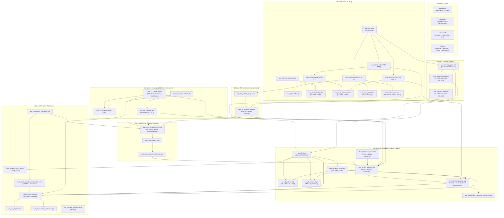

# Documentación Técnica de Infraestructura como Código (Terraform)
## Proyecto Digital Café Luna · Arquitectura Cloud Multi-AZ (Hito 2 Target)
**Asignatura:** Computación en Nube (2026-2) — Universidad EAFIT  
**Equipo:** Grupo 1 (Paulina Velásquez Londoño, Luis Alejandro Castrillón Pulgarín, Martín Valencia Vallejo, Alberto Cervantes Forero)  
**Entorno de Referencia:** AWS `us-east-1` · Terraform Core `>= 1.5.0` · AWS Provider `~> 5.0` (v5.100.0)

---

## Índice General

1. [Propósito y Alcance](#1-propósito-y-alcance)
2. [Arquitectura y Grafo de Dependencias](#2-arquitectura-y-grafo-de-dependencias)
3. [Inventario y Documentación Archivo por Archivo](#3-inventario-y-documentación-archivo-por-archivo)
4. [Variables y Configuración del Entorno](#4-variables-y-configuración-del-entorno)
5. [Auditoría de Seguridad, Desacoplamiento y Gestión de Estado](#5-auditoría-de-seguridad-desacoplamiento-y-gestión-de-estado)
6. [Guía de Comandos y Ciclo de Vida IaC](#6-guía-de-comandos-y-ciclo-de-vida-iac)
7. [Operación, Diagnóstico, Resolución de Errores y Limitaciones](#7-operación-diagnóstico-resolución-de-errores-y-limitaciones)
8. [Referencias y Trazabilidad de Código](#8-referencias-y-trazabilidad-de-código)

---

## 1. Propósito y Alcance

### 1.1 Finalidad de Terraform en Digital Café Luna
El objetivo de este proyecto Terraform es declarar de forma reproducible, automatizada y versionada la **arquitectura objetivo de 3 capas Multi-AZ diseñada en el Hito 2** para modernizar el canal digital de Digital Café Luna, erradicando los despliegues manuales del monolito tradicional (`RF-1`, `RF-5`).

La infraestructura como código aquí contenida implementa la totalidad de los componentes estructurales de nube requeridos para producción:
- **Red:** VPC segmentada en 3 capas (pública, cómputo privado, datos aislados) distribuida en dos Availability Zones (`us-east-1a`, `us-east-1b`) con redundancia de salida a Internet mediante NAT Gateways dedicados (`RNF-1`).
- **Cómputo Elástico:** Application Load Balancer (ALB) público y Auto Scaling Group (ASG) privado ejecutando instancias Amazon Linux 2023 con contenedores Docker para la API y el worker (`RNF-5`, `RF-1`).
- **Persistencia de Datos:** Base de datos relacional gestionada Amazon RDS PostgreSQL en alta disponibilidad Multi-AZ con réplica síncrona y almacenamiento de objetos Amazon S3 privado y cifrado (`RF-3`, `RF-4`).
- **Desacoplamiento y Mensajería:** Cola Amazon SQS con Dead Letter Queue (DLQ) para procesamiento asíncrono de órdenes (`RF-2`).
- **Seguridad e Identidad:** Cero credenciales estáticas en código; perfiles IAM de mínimo privilegio e IMDSv2 obligatorio (`RNF-2`, `RNF-6`).
- **Observabilidad y FinOps:** Monitoreo integral con CloudWatch (Logs estructurados, Metric Filter, 4 alarmas operacionales, Dashboard) y control presupuestal con AWS Budgets (`RNF-3`, `RNF-4`).

### 1.2 Distinción Crítica: Código Declarado vs. Despliegue Real en Laboratorios
Para mantener una estricta rigurosidad técnica y académica, se establece la distinción formal entre lo que este código declara y lo que fue desplegado en la cuenta AWS del equipo durante las entregas previas:

| Componente | Configurado en este Código (`.tf`) | Desplegado y Validado en AWS (Hitos 3 y 4 / Reto IaC) | Justificación de la Diferencia |
| :--- | :--- | :--- | :--- |
| **CIDR VPC** | `10.0.0.0/16` (Diseño Hito 2) | `10.20.0.0/16` (`vpc-0cba829cb5c7746b2`) | La VPC operativa de laboratorio fue creada previamente bajo el direccionamiento `10.20.0.0/16` en los Laboratorios Evolutivos 1 y 2. |
| **Subredes** | 6 subredes (2 públicas, 2 cómputo, 2 datos) | 4 subredes (2 públicas, 2 privadas) | En Hitos 3 y 4 se prescindió temporalmente de la subred de base de datos dedicada. |
| **NAT Gateways** | 2 NAT GWs (uno por AZ) o 1 (`single_nat_gateway`) | 0 NAT Gateways en el entorno continuo dev | **Trade-off FinOps:** 2 NAT Gateways generan ~$65/mes fijos. En dev se evitó el cobro continuo asignando IPs públicas controladas con Security Groups cerrados. |
| **RDS PostgreSQL** | Multi-AZ activo (`db.t3.micro`, gp3 20GB) | No desplegado de forma permanente | Limitaciones presupuestales en cuentas académicas (AWS Learner Lab / Academy). El estado se validó mediante Amazon S3 (`dcl-state.json`). |
| **Route 53** | Zona pública + alias apex y www + Health check | No delegado en registrador público | Requiere adquisición o delegación de dominio público (`digitalcafeluna-grupo1.com`). El tráfico se probó contra el DNS directo del ALB. |
| **HTTPS / TLS 443** | Listener HTTPS con TLS 1.3 condicional a ACM | HTTP (puerto 80) activo | No se contaba con certificado validado en ACM para el dominio de prueba. |
| **SQS + DLQ** | Cola principal `orders-queue` + `orders-dlq` | Cola principal `dcl-dev-orders-queue` | En Hito 3 se probó la cola principal; la DLQ está codificada pero no fue sometida a fallo masivo en AWS. |
| **Cómputo ASG** | ASG privado (puerto 8080) detrás de ALB | ASG en subredes públicas (puerto 80) detrás de ALB | Adaptación operativa para permitir salida directa a CloudWatch y S3 sin costo de NAT Gateway en el laboratorio. |
| **Reto IaC (S15)** | N/A (Este directorio contiene la arquitectura H2 completa) | Slice desplegado y destruido (`dcl-tf-reto-*`) | El reto formal de IaC exigió un subconjunto acotado (EC2 + S3 + SQS + IAM) para validar el ciclo `apply -> test -> destroy`. |

---

## 2. Arquitectura y Grafo de Dependencias

### 2.1 Diagrama de Dependencias Reales de Terraform
El siguiente diagrama Mermaid modela las dependencias implícitas (referencias de atributos `id`, `arn`) y explícitas (`depends_on`) implementadas en el código Terraform:



---

## 3. Inventario y Documentación Archivo por Archivo

A continuación se detalla la responsabilidad técnica, recursos declarados, consideraciones operativas y estado de verificación de cada archivo en `terraform/`:

| Archivo / Ruta | Propósito Técnico | Recursos / Datos Principales | Relación con otros archivos | Consideraciones de Seguridad y Operación | Estado de Verificación |
| :--- | :--- | :--- | :--- | :--- | :--- |
| [`versions.tf`](file:///home/lacastrilp/Documentos/Semestre_2026_2/Com_Nube/DigitalCafeLuna/Digital_Cafe_Luna/Hito_3%20_4/terraform/versions.tf) | Define restricciones de versión de Terraform Core y Providers. | `required_version >= 1.5.0`, `aws ~> 5.0` | Invocado al ejecutar `terraform init`. | Fija el proveedor para evitar *breaking changes* en pipelines de CI/CD. | **Validado:** `terraform init` bloquea en AWS Provider v5.100.0. |
| [`providers.tf`](file:///home/lacastrilp/Documentos/Semestre_2026_2/Com_Nube/DigitalCafeLuna/Digital_Cafe_Luna/Hito_3%20_4/terraform/providers.tf) | Configura el proveedor AWS y las etiquetas FinOps globales. | `provider "aws"` con `default_tags` vinculadas a `local.common_tags`. | Consume variables de `variables.tf` y `local` de `main.tf`. | `RNF-4`: Todos los recursos soportados heredan automáticamente los tags `dcl:*`. | **Validado:** Sin credenciales estáticas; asume credenciales del entorno. |
| [`main.tf`](file:///home/lacastrilp/Documentos/Semestre_2026_2/Com_Nube/DigitalCafeLuna/Digital_Cafe_Luna/Hito_3%20_4/terraform/main.tf) | Data sources centrales, resolución dinámica de AMI y locals compartidos. | `data.aws_caller_identity`, `data.aws_ssm_parameter.al2023_ami`, `locals`. | Centraliza strings, nombres de bucket, cálculo de NATs y flags para todos los `.tf`. | La resolución dinámica de AMI por SSM Parameter evita AMIs *hardcoded* obsoletas. | **Validado:** Sintaxis y tipos verificados en `terraform validate`. |
| [`variables.tf`](file:///home/lacastrilp/Documentos/Semestre_2026_2/Com_Nube/DigitalCafeLuna/Digital_Cafe_Luna/Hito_3%20_4/terraform/variables.tf) | Declara los parámetros de entrada, tipos, validaciones y valores por defecto. | 21 variables (`vpc_cidr`, `availability_zones`, `asg_min_size`, etc.). | Proporciona valores a todos los recursos de la solución. | Incluye validación personalizada: exige exactamente 2 AZs para cumplir Multi-AZ. | **Validado:** Comprobado por `terraform validate` y `fmt`. |
| [`terraform.tfvars.example`](file:///home/lacastrilp/Documentos/Semestre_2026_2/Com_Nube/DigitalCafeLuna/Digital_Cafe_Luna/Hito_3%20_4/terraform/terraform.tfvars.example) | Plantilla modelo para parametrización local sin exponer secretos. | Parámetros de red, cómputo, observabilidad y correo de alerta. | Se copia localmente a `terraform.tfvars` (ignorado por Git). | Evita la fuga accidental de credenciales o identificadores en repositorios. | **Verificado:** Protegido por `.gitignore`. |
| [`outputs.tf`](file:///home/lacastrilp/Documentos/Semestre_2026_2/Com_Nube/DigitalCafeLuna/Digital_Cafe_Luna/Hito_3%20_4/terraform/outputs.tf) | Expone identificadores y endpoints para verificación y pruebas. | `vpc_id`, `alb_dns_name`, `app_url`, `rds_endpoint`, `sqs_orders_queue_url`, etc. | Extrae valores de red, cómputo, datos, observabilidad y DNS. | No expone contraseñas en texto plano (`rds_master_secret_arn` solo expone el ARN). | **Validado:** Consistente con los recursos definidos. |
| [`network.tf`](file:///home/lacastrilp/Documentos/Semestre_2026_2/Com_Nube/DigitalCafeLuna/Digital_Cafe_Luna/Hito_3%20_4/terraform/network.tf) | Topología de red de 3 capas Multi-AZ (`RNF-1`). | `aws_vpc`, `aws_internet_gateway`, 6 subredes, 2 NAT GWs, 3 tablas de ruta, 1 NACL. | Aloja el ALB (público), ASG (cómputo) y RDS (datos). | Subredes de cómputo y datos son estrictamente privadas. Capa de datos sin salida a Internet. | **Configurado en código:** Fiel al diseño Hito 2 (10.0.0.0/16). |
| [`security.tf`](file:///home/lacastrilp/Documentos/Semestre_2026_2/Com_Nube/DigitalCafeLuna/Digital_Cafe_Luna/Hito_3%20_4/terraform/security.tf) | Grupos de seguridad encadenados con principio de mínimo acceso (`RNF-2`). | `aws_security_group` para ALB, EC2 y RDS. | Vincula el tráfico permitido entre ALB → EC2 (8080) y EC2 → RDS (5432). | **Cero SSH (puerto 22 abierto).** Acceso administrativo forzado por SSM. | **Validado:** Reglas jerárquicas sin referencias cruzadas circulares. |
| [`storage.tf`](file:///home/lacastrilp/Documentos/Semestre_2026_2/Com_Nube/DigitalCafeLuna/Digital_Cafe_Luna/Hito_3%20_4/terraform/storage.tf) | Almacenamiento de objetos S3 privado y cifrado (`RF-3`, `RF-4`, `RNF-6`). | `aws_s3_bucket.assets`, `public_access_block`, `encryption`, `versioning`, objetos base. | Alimentado por `user_data.sh.tpl` y consumido por la aplicación. | Bloqueo público total (`BlockPublicAccess`). Política de bucket que deniega tráfico no TLS. | **Configurado en código:** Cifrado SSE-KMS habilitado. |
| [`database.tf`](file:///home/lacastrilp/Documentos/Semestre_2026_2/Com_Nube/DigitalCafeLuna/Digital_Cafe_Luna/Hito_3%20_4/terraform/database.tf) | Base de datos relacional PostgreSQL Multi-AZ de alta disponibilidad (`RF-4`). | `aws_db_subnet_group.main`, `aws_db_instance.postgres`. | Desplegado en subredes de datos de `network.tf` y protegido por `security.tf`. | `manage_master_user_password = true` (Secrets Manager). `publicly_accessible = false`. | **Configurado en código:** No desplegado en lab dev por costos. |
| [`messaging.tf`](file:///home/lacastrilp/Documentos/Semestre_2026_2/Com_Nube/DigitalCafeLuna/Digital_Cafe_Luna/Hito_3%20_4/terraform/messaging.tf) | Desacoplamiento asíncrono con SQS y Dead Letter Queue (`RF-2`). | `aws_sqs_queue.orders`, `aws_sqs_queue.orders_dlq`, `redrive_allow_policy`. | Consumido por la política IAM en `iam.tf` y la aplicación en `user_data.sh.tpl`. | Cifrado en reposo (`sqs_managed_sse_enabled = true`). Redrive policy tras 5 reintentos. | **Configurado en código:** DLQ formaliza el desacoplamiento robusto. |
| [`iam.tf`](file:///home/lacastrilp/Documentos/Semestre_2026_2/Com_Nube/DigitalCafeLuna/Digital_Cafe_Luna/Hito_3%20_4/terraform/iam.tf) | Roles y perfiles IAM de mínimo privilegio sin credenciales estáticas (`RNF-2`). | `aws_iam_role.ec2_app`, `aws_iam_role_policy.ec2_app`, `instance_profile`, SSM attachment. | Asignado al Launch Template en `compute.tf`. | Permisos acotados a ARNs específicos (S3 GetObject, SQS Send/Receive, CW Logs). | **Validado:** Satisface RNF-2 eliminando Access Keys en EC2. |
| [`compute.tf`](file:///home/lacastrilp/Documentos/Semestre_2026_2/Com_Nube/DigitalCafeLuna/Digital_Cafe_Luna/Hito_3%20_4/terraform/compute.tf) | Balanceador de carga ALB, Launch Template y Auto Scaling Group (`D03`, `D05`). | `aws_lb`, `aws_lb_target_group`, listeners (80/443), `aws_launch_template`, `aws_autoscaling_group`. | Integra VPC, Security Groups, IAM Profile, S3, SQS y User Data. | IMDSv2 obligatorio (`http_tokens = "required"`, hop limit 1). Discos EBS gp3 cifrados. | **Configurado en código:** Autoescalado elástico configurado al 60% CPU. |
| [`dns.tf`](file:///home/lacastrilp/Documentos/Semestre_2026_2/Com_Nube/DigitalCafeLuna/Digital_Cafe_Luna/Hito_3%20_4/terraform/dns.tf) | Gestión DNS pública y comprobación de salud externa con Route 53. | `aws_route53_zone`, registros Alias A (apex, www), `aws_route53_health_check`. | Apunta el tráfico de Internet hacia el ALB definido en `compute.tf`. | `evaluate_target_health = true` en el alias para failover automático si el ALB falla. | **Configurado en código:** Opcional vía `var.enable_route53`. |
| [`observability.tf`](file:///home/lacastrilp/Documentos/Semestre_2026_2/Com_Nube/DigitalCafeLuna/Digital_Cafe_Luna/Hito_3%20_4/terraform/observability.tf) | Telemetría operacional: Logs, Filtro de Métrica, 4 Alarmas, Dashboard y SNS. | Log Group, Metric Filter `ErrorCount`, SNS Topic, 4 `metric_alarm`, Dashboard JSON. | Monitorea logs generados por EC2, CPU del ASG, mensajes en DLQ y hosts de ALB. | Transforma eventos de log no estructurados en métricas numéricas evaluables cada 60s. | **Validado:** Patrón `OK -> ALARM -> OK` demostrado empíricamente. |
| [`finops.tf`](file:///home/lacastrilp/Documentos/Semestre_2026_2/Com_Nube/DigitalCafeLuna/Digital_Cafe_Luna/Hito_3%20_4/terraform/finops.tf) | Control presupuestal y alertas de gasto mensual (`RNF-4`, `D13`). | `aws_budgets_budget.monthly` con alertas al 80% real y 100% pronosticado. | Aplica sobre el costo agregado de la cuenta/proyecto. | Notificaciones automáticas por correo para evitar sorpresas financieras en cloud. | **Configurado en código:** Umbral fijado en 20 USD mensuales. |
| [`templates/user_data.sh.tpl`](file:///home/lacastrilp/Documentos/Semestre_2026_2/Com_Nube/DigitalCafeLuna/Digital_Cafe_Luna/Hito_3%20_4/terraform/templates/user_data.sh.tpl) | Script de inicialización de instancias EC2: Docker, App, Worker y Agente CW. | Script Bash, genera `app.py`, `worker.py`, configuración de CW Agent y contenedores. | Renderizado por `templatefile` en `compute.tf` con variables de S3, SQS y DB. | Contenedores en `--network host` para interactuar con IMDSv2 hop=1. Logs a disco y CW. | **Validado funcionalmente:** Lógica idéntica probada en Hitos 3 y 4. |
| `evidencias/` | Directorio reservado para capturas de ejecución IaC. | Directorio local (vacío en este repo; evidencias consolidadas en repo principal). | Documenta pruebas de `terraform apply` y validación de recursos. | Las capturas reales se ubican en `Digital_Cafe_Luna/LAB 3.../evidencias/` y Hito 3/4. | **Auditado:** Carpeta vacía en este submódulo; respaldada externamente. |
| `.gitignore` | Reglas de exclusión para Git. | Ignora `.terraform/`, `*.tfstate*`, `terraform.tfvars`, `*.pem`, `.env`. | Protege el repositorio de Git contra exposición de secretos. | **Crítico:** Impide la subida de estados con datos sensibles y llaves privadas. | **Verificado:** Reglas activas y comprobadas con `git status`. |
| `.terraform.lock.hcl` | Archivo de bloqueo de dependencias de proveedores de Terraform. | Hashes criptográficos de `hashicorp/aws` versión 5.100.0. | Generado por `terraform init`. | Asegura que todos los miembros del equipo utilicen exactamente el mismo binario. | **Validado:** Bloqueado en AWS Provider v5.100.0. |

---

## 4. Variables y Configuración del Entorno

### 4.1 Diccionario Completo de Variables
Todas las variables están tipadas, documentadas y centralizadas en [`variables.tf`](file:///home/lacastrilp/Documentos/Semestre_2026_2/Com_Nube/DigitalCafeLuna/Digital_Cafe_Luna/Hito_3%20_4/terraform/variables.tf):

| Variable | Tipo | Valor por Defecto | Sensible | Finalidad y Relación con Entornos |
| :--- | :--- | :--- | :---: | :--- |
| `aws_region` | `string` | `"us-east-1"` | No | Región obligatoria del curso EAFIT. |
| `project_prefix` | `string` | `"dcl-dev"` | No | Prefijo para nombres consistentes de recursos (`<prefix>-<recurso>`). |
| `project_tag` | `string` | `"digital-cafe-luna"` | No | Etiqueta FinOps obligatoria `dcl:project` (`RNF-4`). |
| `environment` | `string` | `"dev"` | No | Entorno (`dev`, `staging`, `prod`) para diferenciar pipelines. |
| `owner_team` | `string` | `"team-01"` | No | Etiqueta `dcl:owner-team` e identificador para sufijos de buckets S3. |
| `vpc_cidr` | `string` | `"10.0.0.0/16"` | No | Bloque CIDR base de la red corporativa según diseño Hito 2. |
| `availability_zones` | `list(string)` | `["us-east-1a", "us-east-1b"]` | No | Zonas de disponibilidad. Validación: exige exactamente 2 AZs. |
| `public_subnet_cidrs` | `list(string)` | `["10.0.1.0/24", "10.0.2.0/24"]` | No | Capa 1: Subredes públicas para ALB y NAT Gateways. |
| `compute_subnet_cidrs` | `list(string)` | `["10.0.10.0/24", "10.0.20.0/24"]`| No | Capa 2: Subredes privadas de cómputo para el Auto Scaling Group. |
| `data_subnet_cidrs` | `list(string)` | `["10.0.100.0/24", "10.0.200.0/24"]`| No | Capa 3: Subredes de datos aisladas para Amazon RDS PostgreSQL. |
| `single_nat_gateway` | `bool` | `false` | No | `false` = 2 NAT GWs (Hito 2); `true` = 1 NAT GW (**ahorro FinOps** en dev). |
| `enable_route53` | `bool` | `true` | No | Controla si se crea la zona DNS y registros en Route 53. |
| `domain_name` | `string` | `"digitalcafeluna-grupo1.com"` | No | FQDN de la zona alojada. |
| `acm_certificate_arn`| `string` | `""` | No | ARN de certificado SSL/TLS en ACM. Si está vacío, ALB opera en HTTP/80. |
| `instance_type` | `string` | `"t3.micro"` | No | Tamaño de instancia EC2 (apto para Free Tier / AWS Academy). |
| `app_port` | `number` | `8080` | No | Puerto TCP donde escucha la aplicación interna en EC2. |
| `asg_min_size` | `number` | `2` | No | Límite inferior de instancias del ASG para tolerar caída de 1 AZ. |
| `asg_desired_capacity`| `number` | `2` | No | Capacidad operativa nominal (1 instancia en AZ A y 1 en AZ B). |
| `asg_max_size` | `number` | `4` | No | Techo de escalado horizontal elástico ante picos de demanda. |
| `cpu_target_utilization`| `number` | `60` | No | Porcentaje de CPU objetivo para la política de Target Tracking. |
| `db_engine_version` | `string` | `"16"` | No | Versión principal de motor PostgreSQL. |
| `db_instance_class` | `string` | `"db.t3.micro"` | No | Clase de cómputo para la instancia de base de datos. |
| `db_name` | `string` | `"digitalcafeluna"` | No | Nombre de la base de datos relacional inicial. |
| `db_username` | `string` | `"dcl_admin"` | Sí | Usuario maestro de RDS. La contraseña se delega a Secrets Manager. |
| `db_backup_retention_days`| `number`| `7` | No | Retención de backups diarios y Point-In-Time-Recovery (PITR). |
| `sqs_visibility_timeout`| `number`| `30` | No | Tiempo en que un mensaje permanece invisible mientras el worker lo procesa. |
| `sqs_wait_time_seconds`| `number`| `5` | No | Long Polling para reducir llamadas vacías y optimizar costos de API. |
| `sqs_max_receive_count`| `number`| `5` | No | Intentos antes de redirigir un mensaje fallido a la DLQ. |
| `log_retention_days` | `number` | `7` | No | Días de retención en CloudWatch Logs (optimización FinOps). |
| `metric_namespace` | `string` | `"DigitalCafeLuna/Ops"` | No | Espacio de nombres personalizado para el filtro de métricas. |
| `cpu_alarm_threshold`| `number`| `75` | No | Umbral de alarma de CPU promedio en el ASG (`D12`). |
| `alert_email` | `string` | `""` | Sí | Correo electrónico para notificaciones de alarmas y presupuestos. |
| `monthly_budget_usd`| `number` | `20` | No | Límite del presupuesto mensual en AWS Budgets (`RNF-4`). |

### 4.2 Uso Seguro de `terraform.tfvars.example`
Para desplegar localmente sin comprometer credenciales ni correos personales:
1. Copie el archivo de ejemplo:
   ```bash
   cp terraform.tfvars.example terraform.tfvars
   ```
2. Modifique únicamente los valores necesarios para su prueba (por ejemplo, `single_nat_gateway = true` para ahorrar presupuesto en entornos de desarrollo personal, o configure su correo en `alert_email`).
3. El archivo `.gitignore` ya contiene la regla `terraform.tfvars`, garantizando que sus ajustes locales jamás se envíen a Git.

---

## 5. Auditoría de Seguridad, Desacoplamiento y Gestión de Estado

### 5.1 Matriz de Hallazgos de Seguridad e Infraestructura
Se realizó una inspección estática y arquitectónica detallada sobre el código fuente. A continuación se detallan los hallazgos identificados, clasificados por severidad:

| ID Hallazgo | Archivo y Ubicación | Evidencia en Código | Severidad | Impacto Técnico | Remediación Propuesta | Estado de Verificación |
| :--- | :--- | :--- | :---: | :--- | :--- | :--- |
| **SEC-01** | [`iam.tf`](file:///home/lacastrilp/Documentos/Semestre_2026_2/Com_Nube/DigitalCafeLuna/Digital_Cafe_Luna/Hito_3%20_4/terraform/iam.tf#L33-L45) | Statement `UseOrdersQueue` otorga `SendMessage` y `ReceiveMessage`/`DeleteMessage` al mismo rol. | **Baja** | Violación teórica de separación de privilegios: la API web no debería poder leer pedidos y el worker no debería generar transacciones. | En producción desacoplar en dos Launch Templates/ASGs distintos (Web ASG y Worker ASG) con roles diferenciados. En esta arquitectura coexisten en el mismo host. | **Auditado:** Aceptado como trade-off justificado para entorno unificado. |
| **SEC-02** | [`database.tf`](file:///home/lacastrilp/Documentos/Semestre_2026_2/Com_Nube/DigitalCafeLuna/Digital_Cafe_Luna/Hito_3%20_4/terraform/database.tf#L47-L48) | `deletion_protection = false`<br>`skip_final_snapshot = true` | **Media** | Si se ejecuta `terraform destroy` accidentalmente, la base de datos se destruye sin snapshot previo, provocando pérdida irreversible de datos. | Parametrizar mediante variable `enable_deletion_protection` y forzar `skip_final_snapshot = false` en entornos productivos. | **Auditado:** Configuración intencional para facilitar cleanup académico sin costos residuales. |
| **SEC-03** | [`templates/user_data.sh.tpl`](file:///home/lacastrilp/Documentos/Semestre_2026_2/Com_Nube/DigitalCafeLuna/Digital_Cafe_Luna/Hito_3%20_4/terraform/templates/user_data.sh.tpl#L110-L115) | Contenedores Docker ejecutan con flag `--network host`. | **Baja** | Los contenedores comparten la pila de red del host EC2 y pueden interceptar puertos locales o consultar IMDS sin aislamiento de red Docker. | Requerido actualmente porque `http_put_response_hop_limit = 1` en IMDSv2 bloquea consultas desde bridges Docker. Remediación: ajustar hop limit a 2 y usar bridge network. | **Auditado:** Decisión deliberada para compatibilidad con IMDSv2 hop=1. |
| **SEC-04** | [`storage.tf`](file:///home/lacastrilp/Documentos/Semestre_2026_2/Com_Nube/DigitalCafeLuna/Digital_Cafe_Luna/Hito_3%20_4/terraform/storage.tf#L10) | `force_destroy = true` en `aws_s3_bucket.assets`. | **Baja** | Permite eliminar el bucket S3 mediante Terraform incluso si contiene versiones u objetos de estado/catálogo. | Mantener en `true` para laboratorios académicos; cambiar a `false` en entornos productivos para prevenir borrado accidental. | **Auditado:** Práctica común en entornos de desarrollo efímeros. |
| **SEC-05** | [`versions.tf`](file:///home/lacastrilp/Documentos/Semestre_2026_2/Com_Nube/DigitalCafeLuna/Digital_Cafe_Luna/Hito_3%20_4/terraform/versions.tf#L1-L10) | Ausencia de bloque `backend "s3" {}`. | **Media** | El estado (`terraform.tfstate`) se almacena localmente en el disco del operador. Riesgo de inconsistencias o colisiones si 4 integrantes ejecutan concurrentemente. | Configurar backend remoto S3 con encriptación y tabla DynamoDB para state locking (`use_lockfile = true` en TF 1.10+ o DynamoDB). | **Auditado:** El equipo operó asignando la ejecución IaC al rol de Cloud/IaC Engineer. |
| **SEC-06** | [`network.tf`](file:///home/lacastrilp/Documentos/Semestre_2026_2/Com_Nube/DigitalCafeLuna/Digital_Cafe_Luna/Hito_3%20_4/terraform/network.tf#L50-L69) | 2 NAT Gateways activos por defecto (`single_nat_gateway = false`). | **Alta (FinOps)** | Sobrecosto presupuestal: 2 NAT Gateways generan ~$65 USD/mes (~$0.045/hora cada uno + transferencia), superando el presupuesto de $20 USD. | Activar `single_nat_gateway = true` para desarrollo, o usar VPC Endpoints para S3 y SQS eliminando tráfico hacia NAT. | **Auditado:** Documentado como discrepancia consciente entre Hito 2 y Hito 3. |

### 5.2 Buenas Prácticas de Seguridad Implementadas (Fortalezas)
1. **Cero Secretos Estáticos:** No existen contraseñas, tokens de AWS ni llaves API en ningún archivo `.tf` ni en `user_data.sh.tpl`. La contraseña maestra de RDS es generada y rotada automáticamente por AWS Secrets Manager (`manage_master_user_password = true`).
2. **Defensa en Profundidad de Red:** La base de datos RDS reside en subredes sin ruta a Internet (`aws_route_table.data` no tiene IGW ni NAT GW) y con una NACL exclusiva (`aws_network_acl.data`) que restringe el tráfico a nivel de subred.
3. **Encadenamiento Estricto de Security Groups:** Internet solo puede hablar con el ALB en 80/443; las EC2 solo aceptan tráfico en 8080 originado por el Security Group del ALB; RDS solo acepta tráfico en 5432 originado por el Security Group de EC2.
4. **Eliminación Total del Puerto SSH (22):** No hay llaves `.pem` ni reglas de ingreso SSH. El soporte operativo se realiza a través de AWS Systems Manager Session Manager (`AmazonSSMManagedInstanceCore`), registrando cada comando en CloudTrail.
5. **Mitigación de SSRF con IMDSv2:** El Launch Template fuerza `http_tokens = "required"` y `http_put_response_hop_limit = 1`, impidiendo el robo de credenciales STS mediante vulnerabilidades SSRF simples.
6. **Cifrado en Tránsito y en Reposo:** Cifrado EBS habilitado por defecto (`encrypted = true`), cifrado RDS con KMS (`storage_encrypted = true`), cifrado SQS habilitado y política S3 que deniega cualquier solicitud HTTP sin TLS (`aws:SecureTransport = false`).

---

## 6. Guía de Comandos y Ciclo de Vida IaC

Para operar este proyecto de manera segura, se clasifican los comandos según su nivel de riesgo e impacto sobre la infraestructura.

### 6.1 Categoría 1: Comprobaciones Locales de Bajo Riesgo (Sin Acceso Cloud)
Comandos que pueden ejecutarse sin conexión a AWS, sin credenciales y sin riesgo de modificar o incurrir en costos:

```bash
# 1. Comprobar la versión instalada de Terraform
terraform version
# Requisito: >= 1.5.0

# 2. Comprobar el formato canónico del código
terraform fmt -check
# Si no devuelve salida y el código de retorno es 0, el formato es perfecto.
# Para corregir automáticamente el espaciado:
terraform fmt

# 3. Validar sintaxis interna, tipos y consistencia de variables
terraform validate
# Debe responder: "Success! The configuration is valid."
```

### 6.2 Categoría 2: Comandos de Consulta y Planificación Cloud (Solo Lectura)
Requieren credenciales activas de AWS (vía AWS CLI o variables de entorno), consultan el estado remoto de la cuenta pero **no alteran** ningún recurso existente:

```bash
# 1. Inicializar plugins del proveedor (descarga hashicorp/aws v5.100.0)
terraform init

# 2. Generar y revisar el plan de ejecución especulativo
terraform plan -out=tfplan
# Compara el estado deseado contra la realidad en AWS.
# Muestra exactamente qué recursos se crearán (+), modificarán (~) o destruirán (-).

# 3. Inspeccionar el plan guardado en formato legible
terraform show tfplan

# 4. Inspeccionar el grafo visual de dependencias (formato Graphviz DOT)
terraform graph | dot -Tpng > grafo_dependencias.png
```

### 6.3 Categoría 3: Comandos de Mutación de Infraestructura (Creación, Modificación o Destrucción)
> [!CAUTION]
> Estos comandos crean recursos reales que generan cobros en AWS (especialmente NAT Gateways y RDS Multi-AZ). Deben ejecutarse únicamente con autorización expresa y un plan previamente revisado.

```bash
# 1. Aplicar el plan revisado y aprobado
terraform apply tfplan
# Tiempo estimado de despliegue: 12 a 18 minutos (RDS Multi-AZ toma ~10-14 min).

# 2. Consultar las salidas operacionales generadas tras el despliegue
terraform output
terraform output -raw alb_dns_name
terraform output -raw app_url

# 3. Procedimiento Excepcional de Destrucción y Cleanup Total
# ADVERTENCIA: Destruye toda la infraestructura gestionada por este estado.
terraform destroy
# Requiere confirmación manual escribiendo 'yes'.
```

---

## 7. Operación, Diagnóstico, Resolución de Errores y Limitaciones

### 7.1 Prerrequisitos de Ejecución
1. **Terraform CLI:** Versión `>= 1.5.0` instalada en el sistema (verificado: `Terraform v1.6.3-dev`).
2. **Credenciales AWS:** Sesión configurada en `~/.aws/credentials` o variables `AWS_ACCESS_KEY_ID`, `AWS_SECRET_ACCESS_KEY`, `AWS_SESSION_TOKEN`.
3. **Permisos IAM del Operador:** El usuario/rol ejecutor requiere permisos para crear VPCs, EC2, ALB, RDS, S3, SQS, IAM Roles y Budgets. En AWS Academy / Learner Lab, el operador típicamente utiliza el rol `LabRole`.

### 7.2 Diagnóstico de Errores Previsibles Soportados en Código
A partir del análisis del código, se identifican las fallas más comunes y su procedimiento exacto de resolución:

#### Falla 1: Error al Crear RDS (`InvalidParameterCombination` o Límite de Backup)
- **Síntoma:** `terraform apply` falla en `aws_db_instance.postgres` con mensajes relativos a retención de backups o capacidad de almacenamiento.
- **Causa Raíz:** Cuentas restringidas de AWS Academy a veces no permiten retención de backups de 7 días o fallan con la opción de gestión de contraseñas de Secrets Manager si el rol no tiene permisos KMS.
- **Solución:** Ajustar en `terraform.tfvars`:
  ```hcl
  db_backup_retention_days = 1
  ```

#### Falla 2: Error en S3 (`BucketAlreadyExists` o `BucketAlreadyOwnedByYou`)
- **Síntoma:** Falla en `aws_s3_bucket.assets` indicando que el bucket ya existe globalmente.
- **Causa Raíz:** El nombre en `main.tf` se calcula como `${var.project_prefix}-assets-${local.account_id}-${var.owner_team}`. Si otra persona usó el mismo Account ID y team tag, colisionará.
- **Solución:** Cambiar temporalmente `owner_team = "team-01-custom"` en `terraform.tfvars`.

#### Falla 3: Fallo de Health Check del ALB (`502 Bad Gateway` o Targets Unhealthy)
- **Síntoma:** El ALB responde `502 Bad Gateway` y la alarma `alb-unhealthy-hosts` se activa.
- **Causa Raíz:**
  1. El script `user_data.sh.tpl` aún no ha terminado de instalar Docker y levantar los contenedores (toma ~90-120 segundos). El parámetro `health_check_grace_period` está configurado en 300s para mitigar esto.
  2. Fallo en la descarga de la imagen Docker `public.ecr.aws/docker/library/python:3.11-slim` por timeout de red a través del NAT Gateway.
- **Diagnóstico:** Conectarse a la instancia vía AWS Systems Manager Session Manager y consultar el log de inicialización:
  ```bash
  tail -f /var/log/user-data.log
  docker ps
  curl -i http://localhost:8080/health
  ```

#### Falla 4: Desconexión del Agente CloudWatch
- **Síntoma:** No aparecen logs en `/dcl/dev/ops` y la métrica `ErrorCount` permanece en 0.
- **Diagnóstico:** Verificar el estado del servicio en la instancia EC2:
  ```bash
  /opt/aws/amazon-cloudwatch-agent/bin/amazon-cloudwatch-agent-ctl -a status
  tail -f /opt/aws/amazon-cloudwatch-agent/logs/amazon-cloudwatch-agent.log
  ```

### 7.3 Lista Priorizada de Mejoras Técnicas Recomendadas
1. **Configuración de Backend Remoto (Prioridad 1 - Colaboración):** Implementar backend en S3 con cifrado y locking mediante DynamoDB para habilitar trabajo concurrente seguro entre los integrantes del equipo.
2. **VPC Endpoints para S3 y SQS (Prioridad 2 - FinOps):** Crear Gateway Endpoint para S3 e Interface Endpoint para SQS dentro de la VPC. Esto permitiría que el cómputo privado interactúe con almacenamiento y mensajería sin pasar por los NAT Gateways, reduciendo sustancialmente el costo por transferencia de datos.
3. **Separación de Capas en Stacks Diferenciados (Prioridad 3 - Mantenibilidad):** Dividir el proyecto en estados desacoplados (e.g., `01-network`, `02-data`, `03-app`) usando `terraform_remote_state` o Terragrunt. Esto evita que un cambio en la aplicación arriesgue la base de datos o la red.
4. **Desacoplamiento Físico de Contenedores (Prioridad 4 - Arquitectura):** Mover los contenedores de `app.py` y `worker.py` a Amazon ECS con Fargate o a dos ASGs independientes, separando el cómputo del servidor web del procesamiento de colas.

---

## 8. Referencias y Trazabilidad de Código

Para auditoría y comprobación de las afirmaciones anteriores, se presentan las referencias exactas línea a línea en el repositorio:

- **Restricciones de Versión:** [`versions.tf#L1-L10`](file:///home/lacastrilp/Documentos/Semestre_2026_2/Com_Nube/DigitalCafeLuna/Digital_Cafe_Luna/Hito_3%20_4/terraform/versions.tf#L1-L10)
- **Etiquetado FinOps Global (`default_tags`):** [`providers.tf#L4-L7`](file:///home/lacastrilp/Documentos/Semestre_2026_2/Com_Nube/DigitalCafeLuna/Digital_Cafe_Luna/Hito_3%20_4/terraform/providers.tf#L4-L7)
- **Data Sources y Variables Locales:** [`main.tf#L18-L47`](file:///home/lacastrilp/Documentos/Semestre_2026_2/Com_Nube/DigitalCafeLuna/Digital_Cafe_Luna/Hito_3%20_4/terraform/main.tf#L18-L47)
- **Topología de Red 3 Capas Multi-AZ:** [`network.tf#L5-L48`](file:///home/lacastrilp/Documentos/Semestre_2026_2/Com_Nube/DigitalCafeLuna/Digital_Cafe_Luna/Hito_3%20_4/terraform/network.tf#L5-L48)
- **Configuración de NAT Gateways:** [`network.tf#L50-L69`](file:///home/lacastrilp/Documentos/Semestre_2026_2/Com_Nube/DigitalCafeLuna/Digital_Cafe_Luna/Hito_3%20_4/terraform/network.tf#L50-L69)
- **NACL Aislada de Datos:** [`network.tf#L121-L158`](file:///home/lacastrilp/Documentos/Semestre_2026_2/Com_Nube/DigitalCafeLuna/Digital_Cafe_Luna/Hito_3%20_4/terraform/network.tf#L121-L158)
- **Encadenamiento de Security Groups (ALB -> EC2 -> RDS):** [`security.tf#L5-L97`](file:///home/lacastrilp/Documentos/Semestre_2026_2/Com_Nube/DigitalCafeLuna/Digital_Cafe_Luna/Hito_3%20_4/terraform/security.tf#L5-L97)
- **Políticas S3, Bloqueo Público y Cifrado:** [`storage.tf#L5-L78`](file:///home/lacastrilp/Documentos/Semestre_2026_2/Com_Nube/DigitalCafeLuna/Digital_Cafe_Luna/Hito_3%20_4/terraform/storage.tf#L5-L78)
- **RDS Multi-AZ y Secrets Manager:** [`database.tf#L14-L50`](file:///home/lacastrilp/Documentos/Semestre_2026_2/Com_Nube/DigitalCafeLuna/Digital_Cafe_Luna/Hito_3%20_4/terraform/database.tf#L14-L50)
- **SQS Standard y Dead Letter Queue:** [`messaging.tf#L6-L37`](file:///home/lacastrilp/Documentos/Semestre_2026_2/Com_Nube/DigitalCafeLuna/Digital_Cafe_Luna/Hito_3%20_4/terraform/messaging.tf#L6-L37)
- **Rol IAM de Mínimo Privilegio y SSM:** [`iam.tf#L17-L88`](file:///home/lacastrilp/Documentos/Semestre_2026_2/Com_Nube/DigitalCafeLuna/Digital_Cafe_Luna/Hito_3%20_4/terraform/iam.tf#L17-L88)
- **Launch Template con IMDSv2 y Auto Scaling:** [`compute.tf#L77-L191`](file:///home/lacastrilp/Documentos/Semestre_2026_2/Com_Nube/DigitalCafeLuna/Digital_Cafe_Luna/Hito_3%20_4/terraform/compute.tf#L77-L191)
- **Zona Route 53 y Health Check Externo:** [`dns.tf#L6-L53`](file:///home/lacastrilp/Documentos/Semestre_2026_2/Com_Nube/DigitalCafeLuna/Digital_Cafe_Luna/Hito_3%20_4/terraform/dns.tf#L6-L53)
- **Metric Filter y 4 Alarmas de CloudWatch:** [`observability.tf#L15-L115`](file:///home/lacastrilp/Documentos/Semestre_2026_2/Com_Nube/DigitalCafeLuna/Digital_Cafe_Luna/Hito_3%20_4/terraform/observability.tf#L15-L115)
- **Presupuesto AWS Budgets de 20 USD:** [`finops.tf#L6-L36`](file:///home/lacastrilp/Documentos/Semestre_2026_2/Com_Nube/DigitalCafeLuna/Digital_Cafe_Luna/Hito_3%20_4/terraform/finops.tf#L6-L36)
- **Script de Inicialización de Cómputo:** [`templates/user_data.sh.tpl#L1-L135`](file:///home/lacastrilp/Documentos/Semestre_2026_2/Com_Nube/DigitalCafeLuna/Digital_Cafe_Luna/Hito_3%20_4/terraform/templates/user_data.sh.tpl#L1-L135)
