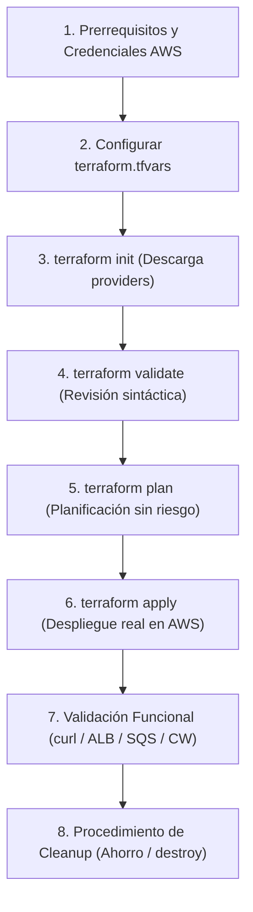

# Guía Paso a Paso para Desplegar la Infraestructura con Terraform
## Proyecto Digital Café Luna · Computación en Nube 2026-2 (EAFIT)
**Directorio de trabajo:** `Hito_3 _4/terraform/`  
**Región AWS:** `us-east-1`  
**Versión de Terraform:** `>= 1.5.0` (Verificado con `v1.6.3`) · **Proveedor AWS:** `~> 5.0` (v5.100.0)

---

## 1. Respuesta Técnica: ¿Hay un User Data en el Terraform?

**SÍ, el proyecto cuenta con un User Data completamente implementado y parametrizado.**

### 1.1 Ubicación en el Código
- **Plantilla fuente:** [`templates/user_data.sh.tpl`](file:///home/lacastrilp/Documentos/Semestre_2026_2/Com_Nube/DigitalCafeLuna/Digital_Cafe_Luna/Hito_3%20_4/terraform/templates/user_data.sh.tpl)
- **Inyección en Terraform:** Se inyecta en [`compute.tf#L104-L117`](file:///home/lacastrilp/Documentos/Semestre_2026_2/Com_Nube/DigitalCafeLuna/Digital_Cafe_Luna/Hito_3%20_4/terraform/compute.tf#L104-L117) dentro del recurso `aws_launch_template.app` usando la función `templatefile`:

```hcl
user_data = base64encode(templatefile("${path.module}/templates/user_data.sh.tpl", {
  region         = var.aws_region
  bucket         = aws_s3_bucket.assets.id
  state_key      = local.state_key
  catalog_key    = local.catalog_key
  queue_url      = aws_sqs_queue.orders.url
  wait_seconds   = var.sqs_wait_time_seconds
  db_host        = aws_db_instance.postgres.address
  db_port        = aws_db_instance.postgres.port
  log_group_name = local.log_group_name
  app_port       = var.app_port
}))
```

### 1.2 ¿Qué hace exactamente este User Data al arrancar cada EC2?
Cuando el Auto Scaling Group (`dcl-dev-asg-web`) crea una nueva instancia EC2 (Amazon Linux 2023), el script ejecuta automáticamente las siguientes 8 tareas con privilegios de `root`:

1. **Instalación de paquetes:** Instala Docker y el agente de CloudWatch (`dnf install -y docker amazon-cloudwatch-agent`) y levanta el servicio Docker.
2. **Identificación segura con IMDSv2:** Obtiene un token de metadatos de sesión (con TTL de 6 horas) y consulta el `instance-id` y la `availability-zone` del nodo.
3. **Descarga de persistencia desde Amazon S3:** Utiliza el rol IAM de la máquina (`dcl-dev-role-web` vía STS, sin llaves estáticas) para copiar `state/dcl-state.json` y `catalog/products.json` a `/opt/dcl/data/`.
4. **Inyección de variables de entorno:** Genera el archivo `/opt/dcl/app/dcl.env` con la URL de la cola SQS, host y puerto de RDS PostgreSQL y nombre del Log Group de CloudWatch.
5. **Crea el microservicio web (`app.py`):** Servidor HTTP en Python escuchando en el puerto 8080 con endpoints para:
   - `GET /health`: Endpoint de salud para el ALB (retorna `HTTP 200`).
   - `GET /`: Muestra el nodo activo (AZ, Instance ID) y el estado leído de S3.
   - `GET /catalog`: Entrega el catálogo de productos.
   - `GET /db-check`: Prueba de conectividad socket TCP al puerto 5432 de RDS PostgreSQL.
   - `GET /simulate-error`: Retorna `HTTP 500` e inyecta una línea `ERROR` en el log para disparar la alarma.
   - `POST /checkout`: Recibe compras, genera un `orderId` y lo encola asíncronamente en SQS.
6. **Crea el worker consumidor (`worker.py`):** Proceso en segundo plano que consume pedidos de la cola SQS mediante *Long Polling* y simula su procesamiento.
7. **Lanza los contenedores Docker:** Ejecuta dos contenedores (`dcl-web` y `dcl-worker`) basados en `public.ecr.aws/docker/library/python:3.11-slim` bajo el modo `--network host`.
8. **Inicia el Agente CloudWatch:** Configura la lectura de `/var/log/dcl/app.log` y transmite los logs estructurados en tiempo real hacia `/dcl/dev/ops`.

---

## 2. Flujo General de Despliegue



---

## 3. Paso a Paso Detallado para el Despliegue

### Paso 1: Prerrequisitos y Comprobación de Sesión Cloud
Antes de ejecutar comandos de Terraform, verifique que tiene instalado Terraform y que su terminal tiene credenciales válidas de AWS (por ejemplo, AWS Academy Learner Lab o una cuenta propia):

```bash
# 1. Comprobar versiones instaladas
terraform version
aws --version

# 2. Confirmar que la sesión de AWS está autenticada y en la región us-east-1
aws sts get-caller-identity
```
*Debe responder un objeto JSON con `Account`, `UserId` y el `Arn` de su identidad.*

---

### Paso 2: Ubicarse en el Directorio y Crear la Configuración Local
Navegue al directorio donde residen los archivos `.tf`:

```bash
cd "/home/lacastrilp/Documentos/Semestre_2026_2/Com_Nube/DigitalCafeLuna/Digital_Cafe_Luna/Hito_3 _4/terraform"
```

Copie la plantilla de variables de ejemplo a su archivo local de variables (este archivo está protegido en `.gitignore` para no subir secretos a Git):

```bash
cp terraform.tfvars.example terraform.tfvars
```

Abra `terraform.tfvars` y verifique o ajuste los parámetros recomendados para laboratorio:

```hcl
aws_region         = "us-east-1"
project_prefix     = "dcl-dev"
project_tag        = "digital-cafe-luna"
environment        = "dev"
owner_team         = "team-01"

# Direccionamiento base
vpc_cidr           = "10.0.0.0/16"
availability_zones = ["us-east-1a", "us-east-1b"]

# RECOMENDACIÓN FINOPS:
# true = Despliega 1 solo NAT Gateway (ahorra ~$32 USD/mes en pruebas de laboratorio)
# false = Despliega 2 NAT Gateways (1 por cada AZ, fiel al diseño de producción)
single_nat_gateway = true

# DNS: Si NO dispone de un dominio público registrado/delegado en Route 53, déjelo en false
enable_route53     = false

# Correo para recibir alertas SNS y notificaciones de AWS Budgets
alert_email        = "estudiante@eafit.edu.co"
monthly_budget_usd = 20
```

---

### Paso 3: Inicializar Terraform (`terraform init`)
Este comando prepara el entorno, analiza las dependencias y descarga el proveedor de AWS (`hashicorp/aws v5.100.0`):

```bash
terraform init
```

*Salida esperada:*
```text
Initializing the backend...
Initializing provider plugins...
- Finding hashicorp/aws versions matching "~> 5.0"...
- Installing hashicorp/aws v5.100.0...
Terraform has been successfully initialized!
```

---

### Paso 4: Validar Formato y Sintaxis (`terraform validate`)
Ejecute las comprobaciones locales de riesgo cero para confirmar que el código no tiene errores tipográficos ni inconsistencias de variables:

```bash
# 1. Comprobar que el espaciado y formato es canónico
terraform fmt -check

# 2. Validar sintaxis interna, tipos y expresiones de recursos
terraform validate
```

*Salida esperada:*
```text
Success! The configuration is valid.
```

---

### Paso 5: Generar y Revisar el Plan de Ejecución (`terraform plan`)
El comando `plan` compara el estado deseado contra la realidad en AWS sin crear ni modificar ningún recurso:

```bash
terraform plan -out=tfplan
```

*Qué debe revisar en la salida del plan:*
- El número total de recursos a agregar (aprox. 35 recursos).
- Verifique que se creen los componentes esperados: VPC, 6 subredes, tablas de ruteo, Security Groups, bucket S3, cola SQS con DLQ, Launch Template con User Data, ASG, ALB y CloudWatch Logs/Alarmas.
- Confirme que no existan destrucciones no planificadas (`Plan: 35 to add, 0 to change, 0 to destroy`).

---

### Paso 6: Aplicar el Plan y Desplegar (`terraform apply`)
> [!IMPORTANT]
> **Tiempo estimado de aprovisionamiento:** Entre **12 y 16 minutos**.  
> Esto se debe a que la creación de **Amazon RDS PostgreSQL Multi-AZ** aprovisiona dos instancias físicas redundantes en dos zonas distintas con almacenamiento cifrado. No interrumpa el proceso.

```bash
terraform apply tfplan
```

Al terminar, Terraform mostrará el resumen del despliegue y todos los `Outputs` operacionales:
```text
Apply complete! Resources: 35 added, 0 changed, 0 destroyed.

Outputs:
alb_dns_name = "dcl-dev-alb-XXXXXXXXX.us-east-1.elb.amazonaws.com"
app_url = "http://dcl-dev-alb-XXXXXXXXX.us-east-1.elb.amazonaws.com"
asg_name = "dcl-dev-asg-app"
rds_endpoint = "dcl-dev-db.XXXXXXXXX.us-east-1.rds.amazonaws.com:5432"
s3_assets_bucket = "dcl-dev-assets-XXXXXXXXXXXX-team-01"
sqs_orders_queue_url = "https://sqs.us-east-1.amazonaws.com/XXXXXXXXXXXX/dcl-dev-orders-queue"
...
```

---

### Paso 7: Validación Funcional de la Solución Desplegada

Una vez terminado el `apply`, espere **90 segundos** a que el script de User Data termine de instalar Docker y levantar los contenedores. Luego ejecute las siguientes pruebas:

#### 1. Comprobar Salud del Balanceador y Aplicación
```bash
export ALB_DNS=$(terraform output -raw alb_dns_name)
curl -i "http://${ALB_DNS}/health"
```
*Respuesta esperada:* `HTTP/1.1 200 OK` con `{"status": "ok", "node": {"instance_id": "i-...", "az": "us-east-1a"}}`.

#### 2. Comprobar Balanceo de Carga y Lectura de Persistencia desde S3
```bash
curl -s "http://${ALB_DNS}/" | jq .
curl -s "http://${ALB_DNS}/" | jq .
```
*Observe que el `instance_id` y `az` alternan entre `us-east-1a` y `us-east-1b`, mientras que el objeto `s3_state` se lee de forma idéntica en ambas.*

#### 3. Comprobar Conectividad Privada a RDS PostgreSQL (Puerto 5432)
```bash
curl -s "http://${ALB_DNS}/db-check" | jq .
```
*Respuesta esperada:* `{"rds_host": "...", "port": 5432, "reachable": true}` (confirma que la cadena de Security Groups permite tráfico desde EC2 hacia RDS).

#### 4. Probar Desacoplamiento Asíncrono con Amazon SQS
```bash
curl -s -X POST "http://${ALB_DNS}/checkout" | jq .
```
*Respuesta esperada:* `HTTP/1.1 202 Accepted` con `{"orderId": "DCL-XXXX", "status": "queued"}`.

#### 5. Probar Telemetría y Alarma en CloudWatch (`OK -> ALARM -> OK`)
```bash
curl -s "http://${ALB_DNS}/simulate-error"
```
*Respuesta:* `HTTP/1.1 500 Internal Server Error`.  
*Efecto observable:* En menos de 90 segundos, la línea `ERROR` registrada en `/var/log/dcl/app.log` es ingerida a CloudWatch Logs, el Metric Filter incrementa `ErrorCount = 1` y la alarma `dcl-dev-ops-alarm` pasa a estado `ALARM`.

---

## 8. Procedimiento de Ahorro y Destrucción (Cleanup)

### Opción A: Ahorro Temporal entre Sesiones (Sin borrar la BD ni la red)
Si no va a usar el entorno durante varias horas pero no quiere esperar los 15 minutos de recrear la base de datos la próxima vez, apague las instancias EC2 llevando el Auto Scaling Group a 0:

```bash
terraform apply -var="asg_desired_capacity=0" -var="asg_min_size=0" -auto-approve
```
*Para reactivarlo después, simplemente ejecute `terraform apply` sin esas variables.*

### Opción B: Destrucción Total y Limpieza de Recursos
Cuando termine definitivamente las pruebas o el laboratorio, destruya todos los recursos para no generar costos residuales:

```bash
terraform destroy
```
*Revise la lista de recursos a destruir e ingrese `yes` cuando lo solicite.*
